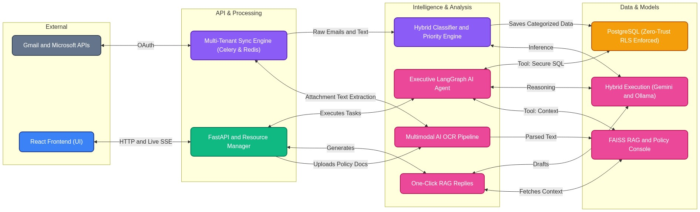

**CENTRE OF EXCELLENCE ON DATA SCIENCE AND MACHINE LEARNING**

DEPARTMENT OF INFORMATION TECHNOLOGY & ELECTRONICS, GOVERNMENT OF WEST BENGAL

# EPIC – EMAIL-BASED PUBLIC INTERACTION & CASE MANAGEMENT

Submitted in fulfillment of the requirements of The Directorate of Technical Education, Govt. of West Bengal.

**Authors:** Anshu Nandi (RCC Institute of Information Technology, Kolkata) & Aditya Ghosh (Institute of Engineering and Management, Kolkata)

## Acknowledgement

The development of EPIC (Email-based Public Interaction & Case Management) was carried out as part of an internship at the Centre of Excellence on Data Science and Machine Learning, Information Technology & Electronics Department, Government of West Bengal.

We extend our sincere gratitude to the Director of CoEDSML, our project mentor Dr. Saptarsi Goswami Sir, management and technical staff at the Centre of Excellence for their guidance, infrastructure support, and domain expertise throughout the project lifecycle. Their insights into the operational challenges faced by the Directorate of Technical Education were invaluable in shaping the design and objectives of this system.

We are grateful to the open-source communities behind FastAPI, LangGraph, Celery, Redis, PostgreSQL, and React, without which this distributed system would not have been feasible.

Finally, we acknowledge the administrative officers of the Directorate of Technical Education, Government of West Bengal, whose real-world grievance management challenges inspired every design decision in this project.

Regards,

**Anshu Nandi** (RCC Institute of Information Technology, Kolkata)
**Aditya Ghosh** (Institute of Engineering and Management, Kolkata)
**Interns, CoEDSML**
**21/05/2026, Kolkata**

## Declarations

We hereby declare that the project titled "EPIC – Email-based Public Interaction & Case Management" is a bonafide record of the work carried out by us during our internship tenure at the Centre of Excellence on Data Science and Machine Learning, Information Technology & Electronics Department, Government of West Bengal, during the period 5th March – 4th June, 2026.

This project report is submitted in partial fulfilment of the requirements of the AI-Assisted Training Initiative. The work presented in this report is original and has been carried out by us, except where due acknowledgment has been made. This report has not been submitted previously to any other university or institution for the award of any degree, diploma, or certification.

The architecture, code, and analytical methodologies described herein represent original intellectual contributions. We further declare that all facts, findings, API specifications, and system descriptions presented in this report are accurate to the best of our knowledge.

---


<div style="display: flex; justify-content: space-between; margin-top: 50px;">
  <div style="text-align: left;">
    _______________________________________<br>
    <b>Anshu Nandi</b><br>
    RCC Institute of Information Technology, Kolkata<br>
    Intern, CoEDSML<br>
    Date: ___________________
  </div>
  <div style="text-align: right;">
    _______________________________________<br>
    <b>Aditya Ghosh</b><br>
    Institute of Engineering and Management, Kolkata<br>
    Intern, CoEDSML<br>
    Date: ___________________
  </div>
</div>

## CERTIFICATE

This is to certify that **Anshu Nandi** (RCC Institute of Information Technology, Kolkata) and **Aditya Ghosh** (Institute of Engineering and Management, Kolkata), who completed a **three-month internship** (5th March 2026 to 4th June 2026) as members of the AI-Assisted Training Team, have successfully completed the project titled:

**“EPIC – Email-based Public Interaction & Case Management”**

at the **Centre of Excellence on Data Science and Machine Learning, Information Technology & Electronics Department, Government of West Bengal**.

The work presented in this project report is a bonafide record of the system design, development, and evaluation carried out by the interns. The report is found to be technically comprehensive, methodologically sound, and practically valuable for digital governance applications.

---


<div style="margin-top: 50px; text-align: right;">
  _______________________________________<br>
  <b>Dr. Saptarsi Goswami</b><br>
  Internship Mentor / Guide<br>
  CoEDSML, IT & E Department, Govt. of W.B.<br>
  Date: ___________________
</div>

Centre of Excellence on Data Science and Machine Learning • IT & E Department, Govt. of West Bengal •

## Abstract

The Directorate of Technical Education, Government of West Bengal, frequently faces a severe operational bottleneck in processing and triaging high volumes of public grievance emails. Manual categorization, priority assessment, and policy-compliant response formulation result in significant delays and administrative friction. To address this challenge, we present EPIC (Email-based Public Interaction & Case Management), a scalable, distributed web application engineered to automate the ingestion, analysis, and management of public inquiries.

EPIC leverages a decoupled, multi-tier architecture. The frontend is a responsive Single Page Application (SPA) built with React, Vite, and Tailwind CSS. The coordination layer relies on FastAPI and Uvicorn to handle asynchronous routing, while persistence is managed through PostgreSQL via a custom connection dialect. To guarantee a non-blocking user experience, heavy computational tasks are offloaded to asynchronous background workers coordinated by Celery and Redis.

At its core, EPIC integrates a Multi-Modal Intelligence Tier driven by a LangGraph ReAct agent, CPU-bound SentenceTransformer embeddings, and local LLM inference via Ollama. This pipeline achieves automated intent recognition, dynamic taxonomy mapping, priority heuristics, multi-modal Optical Character Recognition (OCR) for attachments, and crucially, context-aware policy-based reply generation. By systematically grounding LLM responses in official government policy documents via a Retrieval-Augmented Generation (RAG) framework, EPIC drastically reduces response times while ensuring strict compliance and accuracy. Ultimately, EPIC provides administrative officers with an automated, highly efficient digital framework for modern governance and public case management.

## CONTENTS

- [Chapter 1: Introduction](#chapter-1-introduction)
  - [1.1 Background and Motivation](#11-background-and-motivation)
  - [1.2 Problem Statement](#12-problem-statement)
    - [1.2.1 Inadequate and Inconsistent Email Categorisation](#121-inadequate-and-inconsistent-email-categorisation)
    - [1.2.2 Absence of a Structured Dashboard View](#122-absence-of-a-structured-dashboard-view)
    - [1.2.3 Unprocessed Attachments Losing Critical Information](#123-unprocessed-attachments-losing-critical-information)
    - [1.2.4 No Automated, Policy-Grounded Reply Mechanism](#124-no-automated-policy-grounded-reply-mechanism)
    - [1.2.5 Absence of a Natural Language Interface to the Mailbox](#125-absence-of-a-natural-language-interface-to-the-mailbox)
  - [1.3 Project Objectives](#13-project-objectives)
  - [1.4 Scope of the Project](#14-scope-of-the-project)
- [Chapter 2: System Architecture and Database Design](#chapter-2-system-architecture-and-database-design)
  - [2.1 Overview of System Architecture](#21-overview-of-system-architecture)
  - [2.2 Core Architectural Components and Workflows](#22-core-architectural-components-and-workflows)
    - [2.2.1 The FastAPI Coordination Gateway](#221-the-fastapi-coordination-gateway)
    - [2.2.2 The Multi-Model Hybrid Inference Engine](#222-the-multi-model-hybrid-inference-engine)
  - [2.3 The Hybrid Relational Database Architecture](#23-the-hybrid-relational-database-architecture)
    - [2.3.1 Dynamic Dialect Translation (`session.py`)](#231-dynamic-dialect-translation-sessionpy)
  - [2.4 Database Schema and Entity Definitions](#24-database-schema-and-entity-definitions)
    - [2.4.1 Primary Transactional Table: `emails`](#241-primary-transactional-table-emails)
    - [2.4.2 Configuration and Metadata Tables](#242-configuration-and-metadata-tables)
    - [2.4.3 Background Task Tracking and Audit Logs](#243-background-task-tracking-and-audit-logs)
  - [2.5 The `v_threads` Unified View (Analytic Aggregation)](#25-the-vthreads-unified-view-analytic-aggregation)
    - [2.5.1 Automated Accountability Anchoring](#251-automated-accountability-anchoring)
  - [2.6 Multi-Stage Security & Tenant Isolation](#26-multi-stage-security-tenant-isolation)
    - [2.6.1 Database Row-Level Security (RLS)](#261-database-row-level-security-rls)
    - [2.6.2 LangGraph SQL Safety Wrapper](#262-langgraph-sql-safety-wrapper)
    - [2.6.3 Vector File Partitioning](#263-vector-file-partitioning)
  - [2.7 The Master API Gateway & Reverse Proxy (NGINX)](#27-the-master-api-gateway-reverse-proxy-nginx)
    - [2.7.1 Unified Domain Routing and CORS Mitigation](#271-unified-domain-routing-and-cors-mitigation)
    - [2.7.2 Security Hardening and OWASP Headers](#272-security-hardening-and-owasp-headers)
    - [2.7.3 Container DNS Caching](#273-container-dns-caching)
- [Chapter 3: Email Ingestion and Stealth Sync Engine](#chapter-3-email-ingestion-and-stealth-sync-engine)
  - [3.1 Multi-Protocol Email Integration (Graph API & Gmail)](#31-multi-protocol-email-integration-graph-api-gmail)
    - [3.1.1 OAuth 2.0 Flow and Multi-User Login](#311-oauth-20-flow-and-multi-user-login)
    - [3.1.2 Fernet-Encrypted Refresh Token Storage](#312-fernet-encrypted-refresh-token-storage)
  - [3.2 Stealth Sync Engine](#32-stealth-sync-engine)
    - [3.2.1 Incremental Polling and Dynamic Jitter](#321-incremental-polling-and-dynamic-jitter)
    - [3.2.2 Night Mode Floor (11 PM – 7 AM Auto-Scale-Back)](#322-night-mode-floor-11-pm-7-am-auto-scale-back)
    - [3.2.3 Error Resiliency: Exponential Backoff and Deep Sleep](#323-error-resiliency-exponential-backoff-and-deep-sleep)
    - [3.2.4 Distributed Execution Guards and Revocation Checks](#324-distributed-execution-guards-and-revocation-checks)
  - [3.3 SSE-Driven Push Notifications](#33-sse-driven-push-notifications)
    - [3.3.1 Server-Sent Events Notifier (SSE_NOTIFIER)](#331-server-sent-events-notifier-ssenotifier)
    - [3.3.2 State Transitions: sync_started, sync_complete, refinement_progress](#332-state-transitions-syncstarted-synccomplete-refinementprogress)
  - [3.4 Multimodal OCR and Attachment Processing](#34-multimodal-ocr-and-attachment-processing)
    - [3.4.1 Standard Text Extraction Pipeline](#341-standard-text-extraction-pipeline)
    - [3.4.2 Global Vision Fallback for Scanned PDFs and Images](#342-global-vision-fallback-for-scanned-pdfs-and-images)
    - [3.4.3 Fault Tolerance: [OCR FAILED] Marking for Corrupted Files](#343-fault-tolerance-ocr-failed-marking-for-corrupted-files)
    - [3.4.4 Inline Image Mapping and CID Rewriting](#344-inline-image-mapping-and-cid-rewriting)
- [Chapter 4: Hybrid Categorisation and Prioritisation Pipeline](#chapter-4-hybrid-categorisation-and-prioritisation-pipeline)
  - [4.1 Overview: Dual-Tier Design](#41-overview-dual-tier-design)
  - [4.2 Tier 1 — Expert Keyword Heuristics (Instant)](#42-tier-1-expert-keyword-heuristics-instant)
    - [4.2.1 Regex-Based Normalised Keyword Matching](#421-regex-based-normalised-keyword-matching)
    - [4.2.2 Configurable Priority Scoring Rules](#422-configurable-priority-scoring-rules)
    - [4.2.3 Exact-Name Matching for Custom Dynamic Folders](#423-exact-name-matching-for-custom-dynamic-folders)
    - [4.2.4 Thread Awareness and Auto-Escalation](#424-thread-awareness-and-auto-escalation)
  - [4.3 Tier 2 — LLM Batch Triage (Refined)](#43-tier-2-llm-batch-triage-refined)
    - [4.3.1 Non-Blocking Batch Processing](#431-non-blocking-batch-processing)
    - [4.3.2 Dynamic Expert Priority Rubric](#432-dynamic-expert-priority-rubric)
    - [4.3.3 Priority Escalation Guard: Auto-Escalate After 3 Unresolved Follow-Ups](#433-priority-escalation-guard-auto-escalate-after-3-unresolved-follow-ups)
    - [4.3.4 Rate-Limiting Queue for LLM Call Throttling](#434-rate-limiting-queue-for-llm-call-throttling)
  - [4.4 Structured Grievance Dashboard](#44-structured-grievance-dashboard)
- [Chapter 5: Policy-Aligned RAG based Reply Generation](#chapter-5-policy-aligned-rag-based-reply-generation)
  - [5.1 Policy Document Ingestion](#51-policy-document-ingestion)
    - [5.1.1 Dynamic Metadata and Multi-Format Ingestion](#511-dynamic-metadata-and-multi-format-ingestion)
    - [5.1.2 Advanced Chunking and Table Extraction Architecture](#512-advanced-chunking-and-table-extraction-architecture)
    - [5.1.2 CPU-Only SentenceTransformer Embeddings (all-MiniLM-L6-v2)](#512-cpu-only-sentencetransformer-embeddings-all-minilm-l6-v2)
    - [5.1.3 Per-User FAISS Vector Index (rag_index.faiss)](#513-per-user-faiss-vector-index-ragindexfaiss)
  - [5.2 The "3+2" Surgical RAG Pipeline](#52-the-32-surgical-rag-pipeline)
    - [5.2.1 Context Window: Last 3 Unreplied Emails + 2 Anchor History Turns](#521-context-window-last-3-unreplied-emails-2-anchor-history-turns)
    - [5.2.2 Cosine Similarity Re-Ranking (RAG_MIN_SCORE = 0.35)](#522-cosine-similarity-re-ranking-ragminscore-035)
    - [5.2.3 Preventing Repeated Advice via Anchor-Turn Handshake](#523-preventing-repeated-advice-via-anchor-turn-handshake)
  - [5.3 Grounded Reply Composer](#53-grounded-reply-composer)
    - [5.3.1 Custom AI Persona and the 9-Rule Dynamic Prompt](#531-custom-ai-persona-and-the-9-rule-dynamic-prompt)
    - [5.3.2 Ultimate Fallback List and Hallucination Post-Processing](#532-ultimate-fallback-list-and-hallucination-post-processing)
    - [5.3.3 Confidence Score Display](#533-confidence-score-display)
  - [5.4 VRAM-Aware AI Resource Manager](#54-vram-aware-ai-resource-manager)
    - [5.4.1 GPU Lock During Active User Interactions](#541-gpu-lock-during-active-user-interactions)
    - [5.4.2 Background Worker Auto-Pause and 60-Second Cooldown Resume](#542-background-worker-auto-pause-and-60-second-cooldown-resume)
- [Chapter 6: The Multi-Skill Virtual Policy & Mailbox Assistant](#chapter-6-the-multi-skill-virtual-policy-mailbox-assistant)
  - [6.1 Overview: LangGraph + LangChain Stateful Agent](#61-overview-langgraph-langchain-stateful-agent)
    - [6.1.1 Stateful Interaction Engine](#611-stateful-interaction-engine)
    - [6.1.2 Hardware-Aware LLM Client (CustomChatOllama)](#612-hardware-aware-llm-client-customchatollama)
  - [6.2 Tool-Equipped Cockpit](#62-tool-equipped-cockpit)
    - [6.2.1 emails_sql_tool — Natural Language to Read-Only PostgreSQL Queries](#621-emailssqltool-natural-language-to-read-only-postgresql-queries)
    - [6.2.2 system_health_tool — Unified KPI and Activity Chart JSON](#622-systemhealthtool-unified-kpi-and-activity-chart-json)
    - [6.2.3 policy_rag_tool — Direct FAISS Vector Query](#623-policyragtool-direct-faiss-vector-query)
    - [6.2.4 available_categories_tool — Dynamic Taxonomy Resolver](#624-availablecategoriestool-dynamic-taxonomy-resolver)
    - [6.2.5 thread_narrative_tool — Chronological Thread Audit](#625-threadnarrativetool-chronological-thread-audit)
    - [6.2.6 attachment_explorer_tool — Attachment OCR Text Viewer](#626-attachmentexplorertool-attachment-ocr-text-viewer)
  - [6.3 Safety and Security Guards](#63-safety-and-security-guards)
    - [6.3.1 Read-Only SQL Blocker (Strips DELETE, DROP, UPDATE)](#631-read-only-sql-blocker-strips-delete-drop-update)
    - [6.3.2 Automated user_email Scope Injection for Tenant Isolation](#632-automated-useremail-scope-injection-for-tenant-isolation)
    - [6.3.3 Dashboard Parity Guard via v_threads View](#633-dashboard-parity-guard-via-vthreads-view)
    - [6.3.4 Autonomous JSON-to-SQL Syntax Recovery](#634-autonomous-json-to-sql-syntax-recovery)
    - [6.3.5 LLM Over-Escaping Fix (`\%`)](#635-llm-over-escaping-fix)
  - [6.4 System Prompt and Cognitive Protocols](#64-system-prompt-and-cognitive-protocols)
  - [6.5 LangGraph ReAct Execution Loop](#65-langgraph-react-execution-loop)
- [Chapter 7: Frontend Design and User Interface](#chapter-7-frontend-design-and-user-interface)
  - [7.1 Overview and System Architecture](#71-overview-and-system-architecture)
    - [7.1.1 Custom Design System and Theming](#711-custom-design-system-and-theming)
  - [7.2 Core Interface Components](#72-core-interface-components)
    - [7.2.1 Core Application Shell](#721-core-application-shell)
    - [7.2.2 Dashboard and Data Visualization](#722-dashboard-and-data-visualization)
    - [7.2.3 Inbox Ledger and Data Grids](#723-inbox-ledger-and-data-grids)
    - [7.2.4 Message Threads and Composition](#724-message-threads-and-composition)
    - [7.2.5 Artificial Intelligence and Automation](#725-artificial-intelligence-and-automation)
    - [7.2.6 Configuration and System Management](#726-configuration-and-system-management)
    - [7.2.7 Shared Utilities and Authentication](#727-shared-utilities-and-authentication)
    - [7.2.8 React to FastAPI Intelligence Binding (`intelligence_routes.py`)](#728-react-to-fastapi-intelligence-binding-intelligenceroutespy)
    - [7.2.9 Frontend Data Transformers and Utility Layer](#729-frontend-data-transformers-and-utility-layer)
  - [7.3 API Reference](#73-api-reference)
- [Chapter 8: Limitations and Future Roadmap](#chapter-8-limitations-and-future-roadmap)
  - [8.1 Current Limitations](#81-current-limitations)
  - [8.2 Near-Term Roadmap](#82-near-term-roadmap)
    - [8.2.1 WebSocket Upgrade for Streamed LLM Chatbot Responses](#821-websocket-upgrade-for-streamed-llm-chatbot-responses)
  - [8.3 Long-Term Vision](#83-long-term-vision)
- [Chapter 9: Troubleshooting, Team, and Credits](#chapter-9-troubleshooting-team-and-credits)
  - [9.1 Common Issues and Resolutions](#91-common-issues-and-resolutions)
    - [1. Python WinError 1114 (DLL Initialization Failed)](#1-python-winerror-1114-dll-initialization-failed)
    - [2. OAuth Consent Screen Error 403: access_denied](#2-oauth-consent-screen-error-403-accessdenied)
    - [3. Redirect URI Mismatch (redirect_uri_mismatch)](#3-redirect-uri-mismatch-redirecturimismatch)
    - [4. FAISS Index / Empty Context RAG Errors](#4-faiss-index-empty-context-rag-errors)
    - [5. Fernet Token Decryption Failure (InvalidToken)](#5-fernet-token-decryption-failure-invalidtoken)
    - [6. Ollama Service Unreachable or "Failed to Connect" (ConnectError)](#6-ollama-service-unreachable-or-failed-to-connect-connecterror)
    - [7. VRAM Exhaustion / PyTorch "Out of Memory" (OOM)](#7-vram-exhaustion-pytorch-out-of-memory-oom)
  - [9.2 Diagnostic Commands and Logs](#92-diagnostic-commands-and-logs)
    - [9.2.1 Containerized Stack Diagnostics](#921-containerized-stack-diagnostics)
    - [9.2.2 Relational Store Integrity and Audits](#922-relational-store-integrity-and-audits)
    - [9.2.3 Log File Directories](#923-log-file-directories)
  - [9.3 Project Team and Technologies](#93-project-team-and-technologies)
  - [9.4 Repository Structure](#94-repository-structure)
  - [Appendix A: Complete API Reference](#appendix-a-complete-api-reference)
  - [Appendix B: Glossary](#appendix-b-glossary)
- [Appendix B: Glossary of Terms](#appendix-b-glossary-of-terms)

# Chapter 1: Introduction

## 1.1 Background and Motivation

The Directorate of Technical Education (DTE), Government of West Bengal, serves as the apex regulatory and administrative body overseeing technical and professional education across the state. As the nodal authority for hundreds of affiliated colleges, polytechnics, and professional institutes, the Directorate receives a continuous, high-volume stream of communications from students, faculty, institutions, and citizens seeking redressal of academic, administrative, and procedural grievances.

Historically, grievance communication has been routed primarily through email. While email remains the most accessible and universally adopted channel for formal correspondence with a government body, its unstructured nature creates severe operational bottlenecks at scale. A single administrative officer may receive hundreds of emails per week spanning a broad spectrum of concerns-scholarship disbursements, examination irregularities, affiliation disputes, fee refunds, faculty complaints, and urgent court-referred matters; all arriving in a flat, undifferentiated inbox with no automatic triage, prioritisation, or routing.

The rapid growth of the technical education sector in West Bengal, combined with increasing citizen awareness of digital grievance channels, has further intensified this volume. Manual processing of this workload is not only inefficient but also introduces the risk of critical grievances, such as court orders, examination leakage reports, or Chief Minister's Office (CMO) referrals, being delayed or overlooked due to the absence of automated priority detection.

## 1.2 Problem Statement

The existing email-based grievance management process at the Directorate of Technical Education suffers from five distinct and interconnected architectural and operational problems:

### 1.2.1 Inadequate and Inconsistent Email Categorisation

Incoming grievance emails are not systematically categorised by subject matter, department, or urgency. Without a structured taxonomy, administrators must manually read and classify each email before routing it to the appropriate officer. This leads to fragmented resolution tracking and unreliable operational reporting.

- **Taxonomy Deficit:** No uniform category taxonomy applied across the inbox tier.
- **Triage Delays:** Critical grievance types (e.g., court orders, CMO referrals) remain indistinguishable from routine feedback or casual queries at a glance.

### 1.2.2 Absence of a Structured Dashboard View

The standard email client provides no administrative visibility into the holistic state of the grievance pipeline. There is no consolidated engineering view of unresolved cases, no automated SLA tracking, no volume trend analysis, and no category-level distribution reporting to inform administrative adjustments.

- **Metric Blindness:** No unified KPI dashboard displaying total, resolved, pending, or overdue tracking status metrics.
- **Analytical Void:** Complete lack of data-driven daily volume charts or categorical distribution analytics over time.
- **State Disconnect:** Resolution status is entirely detached from the underlying communication layer, preventing thread-level state tracking.

### 1.2.3 Unprocessed Attachments Losing Critical Information

A significant proportion of incoming grievance emails contain supporting validation documents as attachments—including scanned PDF applications, physical fee receipts, university examination score sheets, legal notices, and institutional certificates. Scanned or image-based documents are entirely non-searchable, effectively siloing crucial evidence.

- **Inaccessible Assets:** Scanned PDFs and rasterized image attachments cannot be read, parsed, or processed by standard email protocols.
- **Indexing Failure:** Attachment payloads remain un-indexed and unsearchable across institutional datastores.
- **Evidence Omission:** Critical evidence deeply embedded inside complex attachments is frequently missed during the baseline manual triage pass.

### 1.2.4 No Automated, Policy-Grounded Reply Mechanism

Composing authoritative replies to grievance emails remains an entirely manual, human-dependent task. Each response requires the responding officer to manually look up or cross-reference the corresponding policy clause or government order. This structural lag introduces severe overhead and exposes the department to inconsistent messaging.

- **Retrieval Lag:** Inability to automatically retrieve and surface relevant regulatory text given an incoming grievance context.
- **Citation Absence:** Draft compositions do not systematically cite governing institutional guidelines, elevating legal and operational exposure.
- **Context Loss:** The system lacks explicit awareness of historical thread contexts, often leading to repetitive or circular advice to a single citizen.

### 1.2.5 Absence of a Natural Language Interface to the Mailbox

Administrators have no intuitive, conversational method to query or audit the underlying grievance database. Answering urgent operational questions requires manual data filtering, extraction, or customized SQL drafting, preventing rapid decision-making.

- **Query Obstruction:** Lack of an ad-hoc natural language processing interface mapped directly to the active grievance relational schema.
- **KPI Inaccessibility:** Real-time system health parameters and complex operational SLA metrics are not accessible instantly on demand.
- **Audit Deficit:** No autonomous, tool-augmented software agent exists to safely audit long-running multi-turn citizen threads.

## 1.3 Project Objectives

The platform is engineered to explicitly resolve each architectural flaw identified in the problem domain. The core development and implementation objectives are categorized below:

- Automate the secure ingestion, extraction, and incremental synchronization of grievance items from both Gmail and Microsoft Outlook (via Graph API) using OAuth 2.0 protocols, managed by a distributed Celery task queue, rate-limit-aware polling engines, and fortified by distributed duplicate and permanent revocation execution guards.
- Deploy a hybrid, dual-tier categorization and prioritization pipeline blending instant, deterministic keyword heuristics with non-blocking LLM batch triage to generate highly precise priority scores (0 to 3), augmented by an interaction-first thread awareness algorithm (detect_followup) for automatic SLA escalation.
- Establish a resilient, multimodal attachment processing cluster utilizing specialized OCR engines and advanced Vision LLM fallbacks to systematically parse scanned documents and corrupted image data.
- Develop a policy-grounded Retrieval-Augmented Generation (RAG) execution workflow that contextually synthesizes, verifies, and drafts formal responses leveraging a rigorous '3+2' conversational window tracking scheme.
- Construct a stateful, tool-equipped Executive Intelligence Assistant powered by LangGraph, providing administrative officers an ad-hoc natural language interface backed by safe, read-only analytical execution tools.
- Deliver an enterprise-grade, high-fidelity React and TypeScript administrative dashboard complete with dynamic chart period selections, reactive data visualization components, and real-time resilient Server-Sent Events (SSE) notification feeds.
- Design and implement a hardware-aware AI Resource Manager (ARM) utilizing distributed Redis locks (across multi-node clusters) and local threading bounds to dynamically govern local system VRAM allocation, preventing thread collisions between active background workers and foreground user tasks.

## 1.4 Scope of the Project

The scope of the system encompasses the end-to-end processing lifespan of a grievance entity within the administrative workflow. Functional boundaries include: secure multi-user credential isolation via encrypted token stores; automated regex-driven and heuristic rule categorization; structural document text extraction; vectorized index compilation and management via local embedding pipelines; context-aware reply drafting with automated verification badges; and a stateful analytical agent possessing deep structural access to data schemas, file explorers, and systemic KPI charts.

Target Deployment Environment: The platform is intentionally scoped for the operational requirements of the Directorate of Technical Education, Government of West Bengal. It is optimized to deploy directly onto on-premise institutional server environments equipped with modest consumer-grade or workstation compute configurations (4 to 8 GB of available VRAM). Out of Scope: The current structural iteration exclusively leverages Google Workspace and Microsoft Azure AD APIs, entirely excluding generic legacy email protocols, and native mobile operating system application wrappers.

# Chapter 2: System Architecture and Database Design

## 2.1 Overview of System Architecture



The EPIC (Email-based Public Interaction & Case Management) platform is designed as a highly scalable, decoupled distributed system capable of processing high-volume public grievance emails through a rigorous AI-driven triage pipeline. The architecture guarantees non-blocking user experiences by offloading heavy, compute-intensive processes (like LLM-based categorization, Vision OCR, and FAISS indexing) to asynchronous background workers.

The system is fundamentally divided into five operational tiers:

1. **The Client Presentation Tier (Frontend)**: A React/Vite Single Page Application (SPA) styled with Tailwind CSS and Radix UI components, utilizing Recharts for data visualization.
2. **The RESTful Coordination Tier (FastAPI)**: A stateless API server utilizing ASGI (Uvicorn) to handle high-concurrency authentication, routing, and asynchronous background task dispatch.
3. **The Multi-Modal Intelligence Tier**: A dynamic inference engine combining LangGraph stateful agents, CPU-bound SentenceTransformer embeddings, and multimodal fallback models (spanning local Ollama to cloud-based Gemini/Vertex AI).
4. **The Hybrid Persistence Tier**: A raw SQL dynamic dialect translation layer capable of seamlessly switching between enterprise PostgreSQL and local SQLite, paired with partitioned FAISS vector stores.
5. **The Containerized Edge Tier**: A fully Dockerized deployment ecosystem (via Docker Compose and Kubernetes) anchored by an NGINX API Gateway, orchestrating Redis message brokers, Celery async workers, and PgBouncer connection pools.

## 2.2 Core Architectural Components and Workflows

### 2.2.1 The FastAPI Coordination Gateway

Operating as the central nervous system, the FastAPI backend (housed in `backend/src/app.py` and `backend/src/routes/`) orchestrates all traffic. It relies on Uvicorn for ASGI deployment, enabling native asynchronous I/O (`async/await`) for all database and API calls.

- **Router Modularization**: Endpoints are strictly partitioned across distinct route handlers (`auth_routes`, `microsoft_auth_routes`, `email_routes`, `intelligence_routes`, `policy_routes`, `settings_routes`, `gmail_routes`, `security_routes`).
- **Distributed Resource Locking**: The system implements an `AI_RESOURCE_MANAGER` (`backend/src/core/resource_manager.py`) to prevent GPU or VRAM out-of-memory (OOM) crashes. It coordinates distributed Redis Mutex locks (or local threading locks in fallback mode) to guarantee that heavy inference operations do not collide.
- **Server-Sent Events (SSE) Engine**: To keep the React UI instantly synchronized with the background Gmail and Microsoft Graph API crawl workers, the `SSE_NOTIFIER` (`backend/src/core/notifier.py`) pushes real-time `sync_started` and `sync_complete` pulse events via a unidirectional HTTP stream.

### 2.2.2 The Multi-Model Hybrid Inference Engine

A defining architectural feature of EPIC is its multi-model failover matrix. Instead of relying on a single monolithic LLM, tasks are routed to the most highly specialized and efficient models based on security constraints and hardware availability. Because the system leverages AI across multiple disconnected components (OCR, Email Triage, Policy RAG, and the Chatbot), the backend relies on a centralized nervous system located in `backend/src/services/ai_utils.py`. All components dispatch inference requests through a singular, robust wrapper function: `generate_content_with_fallback()`.

This core infrastructure provides distinct deployment modes and enterprise-grade guarantees:

- **Fast Semantic Routing**: `Sentence-Transformers` (`all-MiniLM-L6-v2`) runs strictly on the CPU to calculate vector embeddings for incoming policies and RAG queries, intentionally preserving GPU VRAM for generative tasks.
- **Local Secure Inference (`AI_PREFER_LOCAL`)**: Dispatched via `ollama` (e.g., `llama3.2:3b`), this tier handles the bulk of cognitive processing (Chatbot, Triage, RAG Composer) natively on-premise. When the `AI_PREFER_LOCAL` toggle is set to `True`, the `generate_content_with_fallback()` wrapper strictly bypasses all cloud models (even if API keys are present), guaranteeing absolute data sovereignty and an air-gapped environment.
- **Dynamic Enterprise Routing (Vertex AI)**: If configured via `VERTEX_AI_PROJECT`, the AI nervous system bypasses standard developer API keys and automatically pivots to Strict Enterprise Privacy Mode. It initializes a highly secure `genai.Client(vertexai=True)` connection, ensuring data residency and PII encryption requirements are upheld within the isolated Google Cloud Vertex perimeter. To maintain fallback list compatibility, the `generate_content_with_fallback()` router automatically intercepts and strips the `models/` prefix from model strings when Vertex is active. (Only utilized if `AI_PREFER_LOCAL` is disabled).
- **Standard Cloud API (Developer Keys)**: If Vertex AI is not configured, the system gracefully falls back to Google's standard developer endpoints. To prevent global rate-limiting across the platform, the architecture supports distinct key bindings for different services (e.g., `CHATBOT_GEMINI_API_KEY` vs `PRIORITY_GEMINI_API_KEY`). The fallback router actively intercepts HTTP 429 Quota errors and traverses the `ULTIMATE_FALLBACK_LIST` array until a model responds successfully. (Only utilized if `AI_PREFER_LOCAL` is disabled).
- **Resource Coordination (`AI_RESOURCE_MANAGER`)**: When routing to local GPU clusters, the wrapper strictly respects the Global Hardware Lock. It ensures that critical, human-interactive tasks (like the Chatbot and RAG Generator) instantly acquire hardware precedence over background tasks (like bulk OCR or automated Triage), preventing queue starvation on shared VRAM.
- **Multimodal Layout Recovery**: Scanned, distorted, or complex multi-column PDFs and grievance images bypass raw text extraction. If `AI_PREFER_LOCAL` is active, the system rasterizes PDF pages into JPEGs using `pdfplumber` and passes them to local on-premise vision models (like `qwen3-vl:2b` or `moondream`). If disabled, it leverages cloud Vision models (like `gemini-2.5-flash`) which natively 'read' the pixels and reconstruct tabular structures.
- **Stateful Executive Reasoning**: Powered by LangGraph (`create_react_agent`), the system transforms the chosen LLM into an autonomous reasoning loop, capable of executing multi-step physical database queries and vector searches up to a strict recursion limit.

## 2.3 The Hybrid Relational Database Architecture

To support both containerized cloud-native enterprise deployments and lightweight, on-premise local deployments, the database layer (`backend/src/db/`) implements a dynamic SQL Dialect Abstraction Engine.

### 2.3.1 Dynamic Dialect Translation (`session.py`)

Rather than relying on a heavy Object-Relational Mapper (ORM) like SQLAlchemy, the system uses raw SQL for absolute query optimization and fine-grained analytical aggregations. To achieve cross-compatibility between PostgreSQL (for high concurrency) and SQLite (for edge deployments), `session.py` introduces the `PostgresCursorProxy` and a regex-driven `translate_sqlite_to_postgres()` parser.

- **On-the-Fly SQL Translation**: The proxy intercepts SQLite `INSERT OR REPLACE` statements and translates them in real-time into PostgreSQL `ON CONFLICT DO UPDATE` blocks.
- **Type Casting and Aggregations**: The proxy dynamically converts SQLite boolean scalar logic (e.g., `MAX(is_inbox, excluded.is_inbox)`) into PostgreSQL explicit boolean algebra (`(emails.is_inbox OR excluded.is_inbox)`) and translates `MAX()` to `GREATEST()` when operating on Postgres.
- **Connection Pooling**: PostgreSQL deployments utilize `psycopg2.pool.ThreadedConnectionPool` (managed via PgBouncer in production) to handle concurrent bursts from the Celery `StealthSync` workers.

## 2.4 Database Schema and Entity Definitions

The schema (instantiated in `backend/src/db/repository.py`) establishes a highly normalized, referentially intact relational graph.

### 2.4.1 Primary Transactional Table: `emails`

The `emails` table is the core transactional ledger. It utilizes an explicit self-referential graph architecture mapping `id` to `parent_email_id` and `thread_id` to assemble conversational trees. The columns include:

- `id` (TEXT PRIMARY KEY): Unique hash for the internal system.
- `gmail_id` (TEXT UNIQUE): Direct map to the Google Workspace node.
- `thread_id` (TEXT): Groups continuous conversations.
- `parent_email_id` (TEXT): Reconstructs hierarchical reply trees.
- `sender`, `sender_email`, `recipient_email`, `to_address`, `cc_address`, `bcc_address` (TEXT): Routing metadata arrays.
- `subject`, `content`, `html_content`, `attachment_content` (TEXT): The physical message payloads.
- `category` (TEXT), `priority` (INTEGER), `mail_type` (TEXT): Classification outputs from the AI models.
- `has_attachment`, `is_demo`, `replied`, `is_trashed`, `is_inbox`, `is_sent`, `is_priority_refined`, `is_ocr_processed`, `is_resolved`, `manual_override` (BOOLEAN): Explicit state trackers.

### 2.4.2 Configuration and Metadata Tables

- **`categories`**: Stores the dynamic taxonomy schema. Columns: `id`, `name`, `color`, `icon`, `is_active`, `user_email`.
- **`priority_rules`**: A highly malleable configuration table storing custom regex-style keywords and heuristic descriptions. Columns: `priority`, `user_email`, `label`, `keywords`, `description`.
- **`chat_history`**: Tracks multi-turn conversational context for the LangGraph agent. Columns: `id`, `user_email`, `session_id`, `role`, `message`, `timestamp`.

### 2.4.3 Background Task Tracking and Audit Logs

- **`user_sync_history`**: Acts as a distributed checkpoint mechanism for external API sync crawls. Columns: `user_email`, `last_history_id`, `last_sync_completed`, `consecutive_errors`, `sync_interval_seconds`, `auth_provider`, `microsoft_delta_link`.
- **`sync_audit`**: A diagnostic logging ledger tracking execution velocity. Columns: `id`, `user_email`, `sync_type`, `status`, `duration_ms`, `messages_added`, `messages_deleted`, `error_message`, `timestamp`.
- **`revoked_sessions`**: An ultra-fast lookup table housing blacklisted JWT/OAuth tokens severed by the Google RISC webhooks. Columns: `user_email`, `revoked_at`, `reason`.

## 2.5 The `v_threads` Unified View (Analytic Aggregation)

To offload massive state calculation overhead from the Python application layer down to the C-optimized database execution engine, the system implements `v_threads`. This complex SQL view structurally flattens the `emails` table into a real-time dashboard ledger.

```sql
CREATE VIEW v_threads AS
            WITH            abs_latest AS (
                SELECT thread_id, replied, is_resolved, manual_override, mail_type, date, user_email, category, priority, subject, institute_name, has_attachment, content, is_trashed,
                       ROW_NUMBER() OVER (PARTITION BY user_email, thread_id, is_trashed ORDER BY date DESC) as rn
                FROM emails
                WHERE is_inbox = 1
            ),
            citizen_latest AS (
                SELECT thread_id, mail_type, user_email, category, priority, subject, institute_name, content, is_trashed,
                       ROW_NUMBER() OVER (PARTITION BY user_email, thread_id, is_trashed ORDER BY date DESC) as rn
                FROM emails
                WHERE is_inbox = 1 AND is_sent = 0
            ),
            thread_state AS (
                SELECT 
                    a.thread_id, a.user_email, a.replied, a.is_resolved, a.manual_override, a.is_trashed,
                    COALESCE(c.mail_type, a.mail_type) as mail_type,
                    COALESCE(c.category, a.category) as category,
                    COALESCE(c.priority, a.priority) as priority,
                    COALESCE(c.subject, a.subject) as subject,
                    COALESCE(c.institute_name, a.institute_name) as institute_name,
                    COALESCE(c.content, a.content) as content,
                    a.has_attachment,
                    a.date as last_message_date,
                    CASE 
                        WHEN (a.manual_override = 1 AND a.is_resolved = 1) 
                          OR (COALESCE(a.manual_override, 0) = 0 AND (a.replied = 1 OR a.is_resolved = 1)) 
                        THEN 'resolved'
                        WHEN COALESCE(c.mail_type, a.mail_type) = 'fresh' THEN 'fresh'
                        ELSE 'ongoing'
                    END as status
                FROM abs_latest a
                LEFT JOIN citizen_latest c ON a.thread_id = c.thread_id AND a.user_email = c.user_email AND a.is_trashed = c.is_trashed AND c.rn = 1
                WHERE a.rn = 1
            )
            SELECT * FROM thread_state
```

### 2.5.1 Automated Accountability Anchoring

The `v_threads` view computes the live `status` of a grievance using algorithmic accountability logic. If an administrator clicks "Resolve" (`manual_override = 1`), the status locks to `resolved`. However, if the citizen replies *after* resolution, the `LEFT JOIN` on `citizen_latest` overrides the state, instantaneously pushing the grievance back to `ongoing` and forcing the administrator to review the citizen's rebuttal.

## 2.6 Multi-Stage Security & Tenant Isolation

To deploy securely across multiple governmental departments, the architecture strictly enforces multi-tenant boundaries at the database, filesystem, and model-context layers.

### 2.6.1 Database Row-Level Security (RLS)

On PostgreSQL deployments, the backend executes `ALTER TABLE [table] FORCE ROW LEVEL SECURITY;`. It creates strict isolation policies:

```sql
CREATE POLICY tenant_isolation ON emails USING (user_email = current_setting('app.current_tenant', TRUE));
```

This cryptographic guarantee ensures that even if there is a severe bug in the Python router, it is impossible for the system to leak one department's emails to another.

### 2.6.2 LangGraph SQL Safety Wrapper

When the LangGraph agent is granted the `emails_sql_tool` to analyze data, the wrapper algorithmically intercepts the generated SQL string. It strictly forbids `DROP`, `UPDATE`, `INSERT`, and `DELETE` commands, throwing an error instantly if a hallucinated modification is detected. Furthermore, it forcefully injects the `user_email = '{safe_email}'` condition into the `WHERE` clauses of the Abstract Syntax Tree before execution, tightly sandboxing the agent within the active user's workspace.

### 2.6.3 Vector File Partitioning

Instead of a massive, shared FAISS index that would be highly prone to semantic retrieval bleed, the vector store partitions files directly onto the disk (e.g., `rag_{user_email}.faiss` and `chunks_{user_email}.json`). This guarantees absolute physical isolation of policy knowledge bases between disconnected departments, fulfilling stringent government data privacy regulations.

## 2.7 The Master API Gateway & Reverse Proxy (NGINX)

In the containerized deployment architecture, NGINX acts as the unified reverse proxy and master API gateway, securing the internal cluster and streamlining frontend-to-backend communications.

### 2.7.1 Unified Domain Routing and CORS Mitigation

By binding to a single external port (Port 8000), NGINX natively serves the compiled React Single Page Application while utilizing a `rewrite ^/api/(.*) /$1 break` directive to dynamically reverse-proxy `/api` traffic directly to the internal FastAPI (`backend:8000`) cluster. This unified domain architecture entirely eliminates Cross-Origin Resource Sharing (CORS) preflight complexities in production.

### 2.7.2 Security Hardening and OWASP Headers

The configuration (`nginx.conf`) implements rigorous security standards:

- **Information Disclosure Prevention**: Enforces `server_tokens off` to strip NGINX version signatures from error pages.
- **OWASP Security Headers**: Injects mandatory defense headers including `X-Frame-Options "SAMEORIGIN"`, `X-Content-Type-Options "nosniff"`, and a strict `Content-Security-Policy` to mitigate Cross-Site Scripting (XSS) and clickjacking vulnerabilities.
- **DDoS and Brute Force Protection**: Defines explicit `limit_req_zone` memory blocks to throttle inbound traffic, enforcing a strict rate limit on the authentication endpoints (`/api/auth`) and a broader global limit on standard API requests.
- **Payload Restrictions**: Hard-caps `client_max_body_size` to 10MB, inherently blocking massive file upload abuse or memory exhaustion attacks on the downstream Fastapi parsers.

### 2.7.3 Container DNS Caching

To maintain high performance, the NGINX resolver caches the internal Docker bridge IP addresses of the `frontend` and `backend` containers upon initialization. If upstream containers are rebuilt, the infrastructure requires a complete `docker compose down` teardown to flush this cache, preventing stale IP routing and 502 Bad Gateway errors.

# Chapter 3: Email Ingestion and Stealth Sync Engine

## 3.1 Multi-Protocol Email Integration (Graph API & Gmail)

### 3.1.1 OAuth 2.0 Flow and Multi-User Login

The email ingestion pipeline of EPIC is securely connected to both the Google Workspace API and Microsoft Graph API (Azure AD) infrastructures using the OAuth 2.0 authorization framework. The system implements multi-user logical sign-ins within `backend/src/routes/auth_routes.py` (for Google) and `backend/src/routes/microsoft_auth_routes.py` (for Microsoft) to verify identities across varying administrative tiers.

**Google Workspace Flow:** When a departmental nodal officer initiates Google authentication, the server instantiates the `Flow` class from `google_auth_oauthlib.flow` inside the `build_google_flow(state)` helper function. This function uses configuration tokens loaded from the environment variables `GOOGLE_OAUTH_CLIENT_ID`, `GOOGLE_OAUTH_CLIENT_SECRET`, and `GOOGLE_OAUTH_REDIRECT_URI`. The user consent validation request explicitly demands access scopes configured inside the `GOOGLE_OAUTH_SCOPES` environment variable, mapping out the following functional system permissions:

- **gmail.readonly:** Grants administrative read-only access to scan grievance message strings.
- **gmail.send:** Authorizes the backend application to route policy-grounded replies.
- **gmail.modify:** Empowers the ingestion daemon to modify standard message tracking flags.
- **gmail.settings.basic:** Extracts basic metadata profiles to configure structural sorting parameters.
- **userinfo.profile & userinfo.email:** Resolves unique user identities to enforce multi-tenant separation parameters.

Upon granting permission, Google redirects the browser back to `GOOGLE_OAUTH_REDIRECT_URI` (`/auth/google/callback`) with an authorization code and session state. The callback router captures this token and exchanges it for a credentials dictionary via `flow.fetch_token(code=code)`.

**Microsoft Graph API Flow:** For Microsoft accounts, the server constructs an authorization URL targeting `login.microsoftonline.com` using the `MICROSOFT_OAUTH_CLIENT_ID` and `MICROSOFT_OAUTH_REDIRECT_URI`. The consent request similarly demands granular API scopes defined in `MICROSOFT_OAUTH_SCOPES`, mapping to:

- **Mail.ReadWrite:** Grants the background daemon read and write access to scan inbox payloads and manipulate tracking flags.
- **Mail.Send:** Authorizes the system to dispatch automated or drafted grievance responses.
- **User.Read:** Allows the system to resolve the unique active directory profile of the signing officer.
- **offline_access:** Crucial for retrieving long-lived refresh tokens, allowing the StealthSync engine to operate during off-duty cycles.

Upon successful consent, the Microsoft callback utilizes a secure `requests.post` call to exchange the authorization code for an access token payload. The system then issues a secondary HTTP GET request to the Graph API (`https://graph.microsoft.com/v1.0/me`) using the acquired bearer token to securely extract the user's explicit organizational email (`userPrincipalName` or `mail`).

Regardless of the provider, to manage multiple concurrent departmental sessions securely, the system decodes the user's unique identity token, verifies the email address against domain safeguards, and creates a signed session token. This token is signed using the HS256 algorithm via `jwt.encode` with the `APP_SESSION_SECRET` key, and returned to the client as a secure HTTP cookie.

### 3.1.2 Fernet-Encrypted Refresh Token Storage

To support non-interactive background email synchronizations during off-duty cycles, the system must store both Gmail and Microsoft Graph API refresh tokens securely at rest. To protect these high-security credentials, the system implements symmetric AES-256 encryption utilizing the Fernet cryptosystem within `backend/src/core/auth.py`.

When credentials are successfully exchanged, the system executes either `save_google_credentials(user_email, creds)` or `save_microsoft_credentials(user_email, token_data)`, which maps out the following parameters:

- **Email Identity Hashing:** The user's plain-text email address is hashed using the SHA-256 algorithm to generate a secure, irreversible, randomized filename identifier.
- **Symmetric Cryptography:** The credential parameters (access tokens, refresh tokens, and scopes) are serialized into a JSON string, encoded to bytes, and encrypted via a Fernet instance using the `OAUTH_ENCRYPTION_KEY`.
- **Encrypted File Storage:** The resulting encrypted byte array is saved to the persistent host filesystem layer under `backend/storage/data/oauth_tokens/`. Google tokens are saved as `{user_hash}.enc`, while Microsoft tokens are distinctly isolated using an `ms_` prefix (`ms_{user_hash}.enc`).

When background worker threads wake to process incoming mail synchronization tasks, they execute either `load_google_credentials` or `load_microsoft_credentials`. These functions hash the incoming user context, map the targeted `.enc` file, decrypt the binary payload, and dynamically reconstruct the session (or refresh the Microsoft token dynamically via HTTP request if expired). Access tokens are thus never saved as plaintext on host storages.

## 3.2 Stealth Sync Engine

### 3.2.1 Incremental Polling and Dynamic Jitter

The system runs a persistent background syncing task for each authenticated nodal account. Depending on the `TASK_QUEUE_TYPE` deployment configuration, this daemon framework is orchestrated either by distributed Celery worker nodes backed by a Redis message broker (for enterprise scaling) or an asynchronous ThreadPool executor (for lightweight deployments). Both modes utilize an isolated worker architecture to execute concurrency syncing without degrading client HTTP route request latency or server CPU pools. The underlying execution loop loops through a strict sequential pattern:

- **Configuration Check:** The sync engine issues a relational query to the user_sync_history table to extract the account's localized frequency bounds (sync_interval_seconds), defaulting to a baseline SYNC_INTERVAL_SECONDS of 300 seconds.
- **Jitter Application:** To systematically circumvent cloud API rate boundaries and block automated fingerprinting models, the routine computes an active runtime variance: jitter = random.uniform(-SYNC_JITTER_SECONDS * 2, SYNC_JITTER_SECONDS * 2).
- **Wait Time Computation:** The final dynamic thread sleep pause window is evaluated via wait_time = max(180, base_interval + jitter). This acts as a strict Cooldown Safeguard with an unalterable floor limit of 3 minutes (180 seconds) to completely protect the system from being overwhelmed if an impatient user repeatedly clicks the manual refresh button or triggers rate-limits.
- **Incremental Synchronization:** The assigned background worker (Celery or ThreadPool) dispatches the core sync engines (Gmail and Microsoft Graph API) inside the backend/src/integrations/ directory. It evaluates differences against the stored state tokens to download new grievance items selectively.

### 3.2.2 Night Mode Floor (11 PM – 7 AM Auto-Scale-Back)

To save server CPU cycles, storage bandwidth, and cloud network utilities during non-operational office hours, the background StealthSync architecture implements an automated time-aware scale-back mechanism:

- **Time Check Execution:** At the initial boundary of each processing iteration, the system analyzes the host machine's running localized hour: now_hour = datetime.now().hour.
- **Scale-Back Activation:** If now_hour satisfies the scale conditions (hour < 7 or hour >= 23), Night Mode is active. The base sync interval scales back to a minimum floor bound: base_interval = max(base_interval, 3600), locking the synchronization interval to a conservative 1-hour delay.
- **Manual Override Protection:** To maintain high administrative agility, the engine reads the interval_updated_at marker in user_sync_history. If a configuration override was initiated by an officer within the last 8 hours, night mode limits are bypassed.

### 3.2.3 Error Resiliency: Exponential Backoff and Deep Sleep

The sync engine features an advanced, fail-safe error recovery matrix designed to tolerate network interruptions, Microsoft Graph and Google API quota crashes, and systemic HTTP 429 rate throttles. Background sync exception sequences are logged into the consecutive_errors field inside the user_sync_history store. If a sync loop encounters consecutive anomalies, the engine triggers a deep sleep sequence (deep_sleep = 7200, representing a rigid 2-hour delay). The background thread pauses using stop_event.wait(timeout=deep_sleep). This sleep phase resets vulnerable cloud endpoint quotas. The sleep is interruptible via an application stop_event signal during shutdowns, and consecutive_errors resets to 0 upon successful reconnection.

### 3.2.4 Distributed Execution Guards and Revocation Checks

To guarantee stability in scalable multi-node environments, the sync task orchestrator (`backend/src/workers/tasks.py`) implements specialized Redis-backed execution barriers:

- **Permanent Revocation Guard:** At the start of every background execution cycle, the worker evaluates `is_user_revoked(user_email)`. If the departmental user’s access has been formally revoked by an admin, the task instantly halts and exits, ensuring that compromised or terminated accounts instantly lose background processing power.
- **Duplicate Task Guard (Concurrency Locks):** In high-concurrency enterprise environments, message brokers occasionally dispatch duplicate tasks for the same tenant. When using Celery, the engine secures an atomic, short-lived Redis lock (`celery_sync_running_{user_email}`) using the `nx=True` parameter. In localized ThreadPool deployments, an in-memory state tracker serves the same purpose. If a parallel background worker attempts to launch a redundant sync loop for the same officer, it detects the lock and silently exits, drastically reducing duplicated API calls and saving massive computational bandwidth.

## 3.3 SSE-Driven Push Notifications

### 3.3.1 Server-Sent Events Notifier (SSE_NOTIFIER)

To keep the client-side React user interface in sync with background processing pipelines, the system deploys a thread-safe, multi-user asynchronous event pipeline using Server-Sent Events (SSE). The system is managed by the SSENotifier class, instantiated as a global singleton identifier SSE_NOTIFIER inside backend/src/core/notifier.py.

During backend initialization routines (lifespan manager within backend/main.py), the active FastAPI running event loop is bound directly to the global notifier singleton block:

| SSE_NOTIFIER.set_main_loop(asyncio.get_running_loop()) |
| ------------------------------------------------------ |

When a user browser binds to the /events streaming route, the underlying router executes SSE_NOTIFIER.subscribe(user_email), generating an isolated async queue event block (asyncio.Queue()) for that distinct workspace session. When background Celery sync workers require UI updating, they trigger SSE_NOTIFIER.notify(user_email, event_type). This schedules thread-safe insertions via self._main_loop.call_soon_threadsafe(q.put_nowait, event_type), routing notification streams without blocking. Unsubscriptions clear queues upon disconnect, preventing memory leaks.

### 3.3.2 State Transitions: sync_started, sync_complete, refinement_progress

The notification engine broadcasts explicit state tokens that drive the client interface status architectures:

- **sync_started:** Emitted in coordination.py immediately prior to executing sync operations, displaying visual spinning status elements on the dashboard interface.
- **sync_complete:** Emitted when raw header blocks have completed database storage insertion, causing the frontend components to trigger localized table content reloads.
- **refinement_progress:** Dispatched inside process_intelligence_backlog following background LLM processing completions, refreshing visual urgency pill tags and category listings.

## 3.4 Multimodal OCR and Attachment Processing

### 3.4.1 Standard Text Extraction Pipeline

Grievance communications routinely contain verification documentation inside file attachment streams. Structural extraction is routed dynamically by the `extract_attachment_text(path)` gateway module inside `backend/src/services/ocr_service.py`:

- **PDF Documents:** Opened using `pdfplumber.open(path)`, limiting parsing arrays to the first 20 index pages (`pdf.pages[:20]`) to guard against high memory consumption. If standard text extraction yields no text, it seamlessly falls back to the AI Vision Pipeline.
- **Word Assets (`.docx`):** Parsed via the `python-docx` library, reading and joining document paragraph textual structures into monolithic text blocks.
- **Spreadsheet Assets (`.xlsx`):** Handled via `pandas.read_excel`, converting row arrays (restricted to the first 10 data rows) into structured text strings to prevent massive context bloat.
- **Plain Text (`.txt`):** Evaluated through direct filesystem streams, reading characters cleanly while actively ignoring encoding mutations or anomalies.
- **Image Assets (`.png`, `.jpg`, `.jpeg`):** Recognized explicitly as visual formats, the router dynamically bypasses all standard parsing libraries and feeds the images directly into the `extract_text_from_attachment_ai` engine for immediate multimodal OCR processing.

### 3.4.2 Global Vision Fallback for Scanned PDFs and Images

If an attached grievance document represents a flattened graphic raster layout (.png, .jpg, .jpeg) or a scanned image PDF that produces zero text strings from standard document parsers, the extraction cluster automatically shifts execution parameters to the AI Vision pipeline via `extract_text_from_attachment_ai(path)`.

Because vision model architectures handle binary payloads differently, the pipeline actively shape-shifts both the payload and the routing path depending on the deployment configuration. It implements a strictly typed **Tri-Mode Execution Pipeline**:

#### Mode 1: Local Air-Gapped Workflow (Ollama / Local LLM)

If `AI_PREFER_LOCAL` is active, the system assumes an offline deployment.

- **Client Initialization:** The engine safely ignores cloud credentials (evaluating `client=None`) and proceeds without short-circuiting.
- **Image Rasterization:** Because open-weight local vision models (like LLaVA or Qwen-VL) cannot ingest raw PDF blobs natively, the pipeline forcefully intercepts `.pdf` files. It utilizes `pdfplumber` to rasterize the first 5 pages into compressed JPEGs (`resolution=150`, `quality=85`) entirely in memory (`io.BytesIO()`). This preserves visual text legibility while proactively preventing catastrophic out-of-memory (OOM) crashes on constrained local GPU clusters. (If rasterization fails due to severe file corruption, it logs a warning and attempts to pass the raw `application/pdf` byte stream to the model as a final Hail Mary).
- **GPU Resource Coordination (`AI_RESOURCE_MANAGER`):** Before executing the local vision model, the `generate_content_with_fallback` router intercepts the `"OCR Service"` telemetry label. Recognizing it as a VRAM-heavy background task, it invokes `AI_RESOURCE_MANAGER.wait_for_gpu("OCR Service")`—halting the OCR thread until human-interactive Chatbot tasks have released the hardware lock.
- **Payload Unpacking:** The routing wrapper manually unpacks the `types.Part` objects, extracting the JPEG byte streams, and injects them directly into `ollama_client.generate()`.

#### Mode 2: Enterprise Cloud Workflow (Vertex AI)

If `VERTEX_AI_PROJECT` is defined, the system enforces strict data residency.

- **Client Initialization:** The engine completely ignores any standard developer keys and initializes a zero-data-training client via `genai.Client(vertexai=True)`.
- **Native PDF Ingestion:** Cloud models natively support multimodal PDF ingestion. The pipeline skips all memory-intensive rasterization loops, wrapping the raw binary `.pdf` file in a `types.Part(mime_type="application/pdf")` object.
- **Prefix Normalization:** When routing the payload, `generate_content_with_fallback()` detects the Vertex client and automatically strips the `models/` prefix from strings in the `VISION_FALLBACK_LIST` to satisfy Vertex API formatting rules, sending the raw binary straight into the secure Google Cloud perimeter.

#### Mode 3: Standard Cloud Workflow (Gemini API Key)

If neither Local mode nor Vertex mode is active, the system defaults to the developer endpoint.

- **Client Initialization:** Initializes standard `genai.Client(api_key=GEMINI_API_KEY)`.
- **Native PDF Ingestion:** Like Vertex, it skips all local rasterization and passes the raw binary `.pdf` stream directly to the model.
- **Quota Failover:** The router sends the payload using standard model prefixes (e.g., `models/gemini-2.5-flash`). If the developer key is hit with an HTTP 429 Quota or Rate-Limit error, the router dynamically traps the exception and traverses down the `VISION_FALLBACK_LIST` array until a model accepts the payload.

#### Shared Defensive Parsing

Regardless of which mode generated the response, the pipeline concludes with a unified defensive parsing block. Media segments are always merged with the explicit system prompt: *"Extract all legible text from this document for archival purposes... "*. If the generation succeeds, the system attempts to extract `.text`. Because local models occasionally fail to map standard properties to the duck-typed Gemini object, the router utilizes a defensive `hasattr()` cascade to manually extract and concatenate strings deeply nested within the `response.candidates[].content.parts[]` blocks.

### 3.4.3 Fault Tolerance: [OCR FAILED] Marking for Corrupted Files

The system's `extract_attachment_text` engine is highly defensive; if all extraction logic fails or yields no text, it gracefully returns an empty string (`""`). The `process_intelligence_backlog` coordinator then writes this empty string to the database while setting `is_ocr_processed = 1` to prevent infinite background retry loops.

However, if a catastrophic exception (e.g., SQLite lock collision or severe memory exhaustion) bubbles up and breaches the worker thread's outer layer, the system implements an active database isolation layer to protect pipeline flow. The coordinator catches the error and forcefully writes an explicit fault token string, `"[OCR FAILED]"`, straight into the email's `attachment_content` column, while simultaneously setting `is_ocr_processed = 1`. This fault marking guarantees that defective records are bypassed during downstream loops, eliminating stuck background tasks and ensuring stable pipeline throughput.

### 3.4.4 Inline Image Mapping and CID Rewriting

Both Gmail and Microsoft Graph APIs routinely embed inline images directly within the HTML message body using `src="cid:..."` references instead of providing standard hyperlink destinations. During the incremental sync cycle, if the engine detects `cid:` sub-strings within the `html_content` payload, it proactively downloads the base64 media blocks and executes an automated replacement protocol. Using the `_rewrite_html_cids` helper, the backend strips the native Content-ID tags and replaces them with secure, localized API endpoint paths (`__API_BASE_URL__/emails/download/attachment/{unique_filename}`). This ensures that when the React client renders complex HTML grievance layouts, embedded graphical evidence loads natively without requiring the user to manually extract or download the media payload.

# Chapter 4: Hybrid Categorisation and Prioritisation Pipeline

## 4.1 Overview: Dual-Tier Design

The EPIC AI Grievance Intelligence System employs a sophisticated, high-throughput Dual-Tier Hybrid Triage and Categorisation Pipeline engineered specifically to solve the structural tension between immediate platform responsiveness and high-precision contextual text classification. When a citizen grievance is ingested via Gmail sync loops or the manual administrative dashboard interface, it undergoes an optimized execution layout consisting of an instant Tier 1 heuristics scan followed by a deferred, non-blocking Tier 2 large language model (LLM) batch triage cycle. This decoupled engineering layout guarantees that zero administrative or user paths are blocked waiting for third-party API network handshakes, while ensuring that the final data attributes committed to PostgreSQL are robust, verifiable. The pipeline cleanly separates classification concerns into two isolated, sequential operations:

- **Tier 1 (Instant Expert Keyword Heuristics):** Executes synchronously within the background Gmail inbox ingestion path. Coded in pure Python within backend/src/services/triage_service.py as classify_grievance_heuristic and calculate_priority_heuristic, this engine analyzes incoming payloads in sub-milliseconds. It maps regex text models against compiled rules and frequency tables to commit instant default folders and default sorting parameters, avoiding untriaged record blockages.
- **Tier 2 (Asynchronous LLM Batch Triage):** Routes unrefined data records asynchronously within backend/src/core/coordination.py. It polls active records in slices bounded by the AI_BATCH_SIZE parameter, sending structured composite texts to high-precision generative models handled inside backend/src/services/triage_llm.py. Leveraging the ULTIMATE_FALLBACK_LIST model sequence, it executes deeper evaluations regarding stakeholder sentiments and regulatory rubrics to adjust and lock final tracking variables.

## 4.2 Tier 1 — Expert Keyword Heuristics (Instant)

### 4.2.1 Regex-Based Normalised Keyword Matching

The primary sorting layer is invoked by classify_grievance_heuristic(). When a sync daemon commits an inbound email text block to the transactional datastore, the heuristic component normalizes and extracts targeted string tokens using four optimized pipeline stages:

- **HTML Strip:** Raw email markups are instantly stripped from the message body using pre-compiled regex clean patterns: re.sub(r'<[^>]+>', ' ', str(text)). This eliminates parsing noise and ensures raw script fragments do not bias keyword match frequencies.
- **Composite Field Generation:** To enforce contextual significance, the system aggregates the subject string, clean message body, and extracted attachment text blocks into a single string macro. Crucially, the subject string is added twice (`Composite Text = Subject + Subject + "\n" + Clean Body + "\n" + OCR Text`) to amplify its semantic weight mathematically.
- **Regex Word Boundary Matching:** The composite block text is fully converted to lower-case values. To avoid false-positive sub-string matches (such as matching "tender" within "pretender"), the engine strictly enforces regex word boundaries: pattern = r'\b' + re.escape(keyword.lower()) + r'\b'.
- **Weighted Scoring Metrics:** Keywords are evaluated using dynamic weights. Compound terms featuring internal spaces (e.g., "semester routine" or "scholarship portal") are mapped with a double weight multiplier (factor 2) relative to basic single-word strings (factor 1) due to their enhanced information density.

The baseline keywords dictionary definitions used by the heuristic worker match the structured criteria below:

```python
CATEGORIES = {
    "Suspension / Disciplinary": [
        "suspension", "suspended", "suspend",
        "chargesheet", "charge sheet", "charge-sheet",
        "disciplinary", "discipline", "disciplinary action",
        "departmental proceeding", "departmental proceedings",
        "departmental inquiry", "departmental enquiry",
        "dismissal", "dismissed", "termination",
        "punishment", "penalty", "penal action",
        "misconduct", "violation", "breach",
        "show cause", "show-cause", "showcause",
        "investigation",
        "suspended employee", "suspended staff",
        "suspended official", "suspended officer",
        "suspension status", "suspension order"
    ],

    "Legal Issues": [
        "fir", "first information report",
        "arrest", "arrested", "arresting",
        "police", "police case", "police complaint",
        "court", "court case", "court order",
        "legal", "legal case", "legal matter",
        "litigation", "lawsuit", "suit",
        "criminal", "criminal case", "criminal complaint",
        "warrant", "bail", "custody",
        "judgment", "judgement", "verdict",
        "hearing", "trial", "proceedings",
        "advocate", "lawyer", "attorney",
        "petition", "appeal", "writ",
        "contempt", "injunction", "stay order"
    ],

    "RTI Matters": [
        "rti", "right to information",
        "information request", "rti application",
        "rti appeal", "rti reply",
        "public information officer", "pio",
        "first appellate authority", "faa",
        "rti response", "rti filing",
        "disclosure", "transparency",
        "rti order", "rti case"
    ],

    "CMO Issues": [
        "cmo", "chief minister office",
        "chief minister's office", "cm office",
        "cm complaint", "cm grievance",
        "cm cell", "cmo reference",
        "cmo complaint", "cmo matter",
        "referred by cmo", "cmo letter"
    ],

    "Semester / Examination": [
        "semester", "semesters",
        "exam", "exams", "examination", "examinations",
        "marks", "mark", "grade", "grades",
        "result", "results",
        "admit card", "admitcard", "admission card",
        "backlog", "backlogs", "back paper",
        "supplementary", "supplementary exam",
        "re-examination", "reexamination",
        "cgpa", "sgpa", "gpa",
        "pass", "fail", "failed",
        "detention", "promoted",
        "credit", "credits", "attendance",
        "marksheet", "mark sheet", "transcript"
    ],

    "Scholarship & Fee Concession": [
        "scholarship", "scholarships",
        "svmcm", "swami vivekananda",
        "student credit card", "credit card loan",
        "oasis", "oasis scholarship",
        "merit cum means", "mcm",
        "freeship", "free ship",
        "fee waiver", "fee concession",
        "fee exemption", "tuition waiver",
        "stipend", "financial aid",
        "minority scholarship", "sc scholarship", "st scholarship",
        "obc scholarship", "post matric", "pre matric"
    ],

    "Purchase / Procurement Issues": [
        "purchase", "procurement", "procure",
        "tender", "tenders", "e-tender",
        "quotation", "quotations", "rfq",
        "supply", "supplier", "vendor",
        "contract", "work order",
        "gemportal", "gem portal", "government e-marketplace",
        "rate contract", "rate contracts",
        "bill", "bills", "invoice", "invoices",
        "payment pending", "due payment",
        "purchase order", "purchase committee"
    ],

    "Cash Issues": [
        "cash", "cash misappropriation",
        "embezzlement", "misuse of funds",
        "financial irregularity", "financial fraud",
        "fund diversion", "diversion of funds",
        "accounts", "accountant",
        "audit", "audit report", "audit objection",
        "treasury", "treasury challan",
        "grant", "grant utilization", "utilization certificate",
        "budget", "expenditure", "overspending",
        "misappropriation", "fraud", "corruption"
    ],

    "Anti-Ragging Complaints": [
        "ragging", "anti-ragging", "anti ragging",
        "rag", "ragged", "ragging complaint",
        "ragging incident", "ragging case",
        "ugc anti ragging", "aicte anti ragging",
        "senior junior", "bullying", "harassment",
        "hostel ragging", "campus ragging",
        "ragging committee", "anti ragging committee"
    ],

    "Accreditation & Ranking": [
        "naac", "nba", "nirf",
        "accreditation", "accredited",
        "ranking", "rankings",
        "naac grade", "naac score", "naac visit",
        "nba accreditation", "nba status",
        "nirf ranking", "nirf submission",
        "iqac", "internal quality assurance",
        "peer team", "accreditation report",
        "self study report", "ssr",
        "institutional grading"
    ],

    "Service Matters": [
        "transfer", "transferred", "transferring",
        "posting", "posted",
        "promotion", "promoted",
        "service book", "service record",
        "pay fixation", "salary", "increment",
        "appointment", "appointed",
        "deputation", "deputed",
        "leave", "leave application", "leave sanction",
        "retirement", "pension", "pensionary",
        "gratuity", "provident fund", "gpf", "epf",
        "seniority", "seniority list",
        "confirmation", "confirmed",
        "probation", "probationary",
        "regularization", "regularized",
        "pay scale", "pay revision", "arrear",
        "service matter", "service dispute"
    ],

    "Appointment Issues": [
        "appointment", "appointed", "appointment order",
        "recruitment", "recruited",
        "selection", "selection process",
        "interview", "walk-in interview",
        "advertisement", "vacancy", "vacancies",
        "joining", "joining letter", "joining date",
        "offer letter", "appointment letter",
        "contractual", "ad hoc", "adhoc",
        "part time", "guest lecturer", "guest faculty",
        "direct recruitment", "dr", "merit list"
    ],

    "Transfer Cases": [
        "transfer", "transfer order", "transfer case",
        "mutual transfer", "transfer request",
        "inter district transfer", "intra district transfer",
        "transfer posting", "place of posting",
        "transfer grievance", "transfer complaint",
        "transfer list", "transfer policy",
        "hardship transfer", "medical grounds transfer",
        "transfer cancellation", "transfer stay"
    ],

    "Inspection Matters": [
        "inspection", "inspected", "inspector",
        "inspection report", "inspection team",
        "inspection visit", "inspection findings",
        "site inspection", "physical inspection",
        "compliance", "compliance report",
        "deficiency", "deficiencies",
        "inspection committee", "inspection order",
        "surprise inspection", "routine inspection"
    ],

    "Seat Matrix Issues": [
        "seat matrix", "seat matrices",
        "seats", "intake", "intake capacity",
        "seat allocation", "seat allotment",
        "seat increase", "seat reduction",
        "additional seats", "excess seats",
        "counselling seats", "wbjeeb", "jelet",
        "lateral entry", "seat approval",
        "aicte approval", "university affiliation",
        "affiliated seats", "approved intake"
    ],
}
```

### 4.2.2 Configurable Priority Scoring Rules

Rather than depending exclusively on hardcoded keywords, the architecture enables authorized Nodal Officers to define custom priority rules within the PostgreSQL datastore, creating an adaptive, localized routing fabric:

- **Custom Priority Rules Table:** The priority_rules schema maps specific keywords, unique urgency tiers, and target user accounts, providing isolated runtime filters per workspace.
- **Custom Rule Extraction:** Within calculate_priority_heuristic(), the execution logic triggers get_priority_rules(user_email) to load rules dynamically at execution runtime.
- **Ordered Urgency Scan:** The rule arrays are sorted in ascending order based on the priority value (0 for critical to 3 for routine). Sweeping higher urgency metrics first ensures that high-impact booster keywords override lower rules immediately, eliminating priority boundary conflicts.

The runtime execution block handling custom keyword evaluation matches the functional structure below:

```python
def calculate_priority_heuristic(content: str, subject: str, user_email: str = None) -> int:
    text = f"{subject} {content}".lower()
    if user_email:
        try:
            from db.repository import get_priority_rules
            rules = get_priority_rules(user_email)
            for r in sorted(rules, key=lambda x: x["priority"]):
                level = r["priority"]
                keywords = r["keywords"]
                for kw in keywords:
                    if re.search(r'\b' + re.escape(kw.lower()) + r'\b', text):
                        return level
            return 3  # Fallback Default
        except Exception as e:
            logger.error(f"⚠️ [Heuristic] Custom rules loading failed: {e}")
```

### 4.2.3 Exact-Name Matching for Custom Dynamic Folders

To support localized department divisions within the Directorate of Technical Education (e.g., "WBSCTE Exam Cell"), the engine evaluates custom categories added via the admin settings panel. During text scanning, active folder records are pulled via get_active_categories(user_email). If an incoming text matching block matches a custom dynamic folder name exactly, the system applies an amplified multiplier of 3.0 (category_scores[c_name] += matches * 3.0) to the score array. This weight booster ensures that explicitly addressed folders override generic keyword groups, funneling grievances directly into specialized workflows.

Tie-Breaking Parameters: If two distinct categories attain equal heuristic cumulative scores, the conflict is handled by an explicit precedence ladder. The engine favors long-established base categories defined in config.py first, and defaults to alphabetical sorting for dynamic categories to guarantee completely deterministic results during high-concurrency ingestion.

### 4.2.4 Thread Awareness and Auto-Escalation

To maintain context across long-running grievance chains, the system implements an interaction-first `detect_followup` algorithm within `backend/src/services/triage_service.py`. It dynamically classifies an inbound email as "Fresh", "Follow-up", "Action" (if proactively initiated by the officer), or "Reply" based on the email's presence in previous threads and sender comparisons.

Additionally, an `apply_thread_escalation` function enforces an automated SLA safeguard: if an external citizen has followed up more than three times (`followup_count > 3`) and the grievance priority is lower than Level 1 (High), the system automatically escalates its urgency by one unit (capped at Level 1). This ensures that persistent, unresolved citizen inquiries bypass routine queues and are highlighted for immediate administrative intervention.

## 4.3 Tier 2 — LLM Batch Triage (Refined)

While heuristics provide rapid triage, natural language can be highly ambiguous. For example, a student email regarding a "lack of water in the hostel mess" could trigger Academics, Infrastructure, or Miscellaneous folders. Tier 2 addresses this semantic ambiguity via a background AI refinement worker that evaluates incoming items in decoupled batch cycles.

### 4.3.1 Non-Blocking Batch Processing

To control API token consumption and protect host system compute capabilities, the background worker managed within backend/src/core/coordination.py executes bulk evaluations using a non-blocking process model:

- **Text Summarization Limits:** Email message contents are truncated to 700 characters and extracted OCR blocks are restricted to 500 characters. This minimizes token counts while retaining core grievance parameters.
- **FastAPI Non-Blocking Execution:** The processing loops are handled via a dedicated ThreadPoolExecutor infrastructure initiated by submit_intelligence_task(). This prevents background inference steps from competing with client-facing HTTP response pipelines.

```python
def process_intelligence_backlog(user_email: str):
    """
    The actual worker task that performs OCR and AI triage in batches.
    Processes batches until clear, sleeping between batches to respect rate limits.
    """
    from config import AI_BATCH_SIZE, PRIORITY_LLM_WINDOW_SECONDS
    import time
  
    try:
        # Phase A: OCR for attachments (Top 10) - Independent Fault Tolerance
        try:
            unprocessed_attachments = get_unprocessed_attachments(user_email, limit=10)
            if unprocessed_attachments:
                logger.info(f"🔍 [Worker] Found {len(unprocessed_attachments)} pending attachments for OCR.")
              
            for att in unprocessed_attachments:
                if worker_manager.should_stop_intelligence(user_email): return
              
                logger.info(f"🛰️ [OCR-Worker] Processing: {att['filename']}")
                try:
                    text = extract_attachment_text(att['local_path'])
                    # Even if text is empty, we must mark it as processed to avoid infinite retries
                    update_email_attachment_content(
                        user_email, att['email_id'], text or "", 
                        att['filename'], att.get('original_name')
                    )
                except Exception as file_err:
                    logger.error(f"❌ [OCR-Worker] Extraction failed for {att['filename']}: {file_err}")
                    # Mark as processed with failure marker to prevent blockages
                    update_email_attachment_content(
                        user_email, att['email_id'], "[OCR FAILED]", 
                        att['filename'], att.get('original_name')
                    )
                  
        except Exception as ocr_err:
            logger.error(f"⚠️ [Enrichment] OCR Phase failed: {ocr_err}")
```

### 4.3.2 Dynamic Expert Priority Rubric

The batch triage framework instructs the backend generative model to evaluate texts against a dynamic, multi-tier governmental urgency framework. Instead of a rigid hardcoded prompt, the system utilizes `db.repository.get_priority_rules` and `get_global_rules` to dynamically inject layman-configured priority criteria, labels, and global guardrails defined by the Nodal Officer into the core LLM prompt payload at runtime.

If no custom rules are configured, the system falls back to a default baseline rubric mapping to four explicit urgency tiers:

| **Priority** | **Designation** | **Government Context Criteria**                                                                                                                             | **Trigger Examples**                                         |
| ------------------ | --------------------- | ----------------------------------------------------------------------------------------------------------------------------------------------------------------- | ------------------------------------------------------------------ |
| Level 0            | Critical              | Chief Secretary mandates, High Court judicial notices, RTI statutory filings, examination question paper leaks, severe safety hazards, or system compromises.     | "Contempt of court", "RTI Appeal", "Paper leaked for physics exam" |
| Level 1            | High                  | Anti-ragging violations, physical FIR logs, direct Chief Minister Office (CMO) or ministerial references, major pension/salary delays, financial fraud anomalies. | "Ragged by seniors in dorm", "pension not credited for 6 months"   |
| Level 2            | Medium                | Tender blockages, academic seat allocation caps, accreditation deadlines (NAAC/NBA), employee leave evaluations, standard scholarship portal queries.             | "NBA self assessment report submission"                            |
| Level 3            | Routine               | General software feedback, basic portal suggestions, informational inquiries, non-actionable tracking status queries.                                             | "When will classes start", "Nice portal design"                    |

The triage prompt enforces explicit guardrails. First, output structures must match a strict JSON object mapping the numeric index keys to priority and category text strings. Second, output categories are matched case-insensitively against active database schemas, automatically defaulting to "Miscellaneous" if a parser anomaly or token corruption occurs. Most importantly, it enforces an 'Upgrade-Only' safety strategy: the AI evaluates the text for deep contextual urgency (such as citizen distress or legal threats), and the coordination layer ensures that the initial keyword-based baseline assigned by Tier 1 is never improperly downgraded by the LLM.

### 4.3.3 Priority Escalation Guard: Auto-Escalate After 3 Unresolved Follow-Ups

To prevent citizen grievances from getting lost in high-volume mail queues, the core architecture enforces an automated conversational depth safety net inside backend/services/triage_service.py via apply_thread_escalation():

```python
def apply_thread_escalation(priority: int, followup_count: int) -> int:
    """Escalates priority by 1 unit (capped at High / level 1) if followup threshold (>3) is breached."""
    # Ensure priority defaults to 3 if completely None, but preserve 0 explicitly (avoiding falsiness bugs)
    p = 3 if priority is None else priority
    if (followup_count or 0) > 3 and p > 1:
        return max(1, p - 1)  # Escalates by 1 unit, capped at High (level 1)
    return p
```

**Smart Context Memory and Interaction Tracking:** During intake tracking, the detect_followup() module acts as a Smart Context Memory engine. It evaluates inbound messages against existing data rows to seamlessly link the history of previous replies. It instantly recognizes and flags a thread as "fresh" if no prior records exist; "action" if an officer initiates an outbound response first; "reply" if an inbound item responds to an outbound message; and "follow-up" if a citizen transmits multiple consecutive unreplied messages. This memory guarantees emails are grouped consistently like a single, organized case file, and the follow-up state increments followup_count by 1, automatically triggering the Level 1 priority escalation guard.

### 4.3.4 Rate-Limiting Queue for LLM Call Throttling

To guard against API quota exhaustion and avoid thread stalls when using local inference servers, the intelligence framework implements a sliding-window rate-limiting queue protected by an exclusive tracking lock (threading.Lock()). If the token validation checker confirms that maximum call parameters (PRIORITY_LLM_MAX_CALLS per PRIORITY_LLM_WINDOW_SECONDS window) are breached, the system logs a rate limit event ("Triage LLM rate limit reached; using heuristic fallback") and bypasses the AI step, defaulting safely to Tier 1 metadata.

## 4.4 Structured Grievance Dashboard

To help Nodal Officers quickly assess queue health, monitor pipeline velocity, and evaluate compliance with departmental SLAs, the React frontend includes a comprehensive analytical dashboard component (frontend/src/components/Dashboard.tsx) driven by recharts data visualization tools.

- **Dynamic Period Filters:** Allows administrators to seamlessly toggle between dynamic chart period selections (e.g., 7 Days, 30 Days, All Time) to filter underlying charting components.
- **Stat Metric Layout Cards:** Renders real-time, high-level summary cards showing metrics such as Total Conversations, Resolved Cases, Fresh Intake counts, and Unresolved Items (displaying dynamic sub-labels tracking Average Pending Duration).
- **Dynamic Category Distribution Chart:** A responsive recharts `<BarChart>` that maps out grievance distributions across active folders. It extracts counts dynamically, filters empty states, and applies specialized fill parameters matching each category's configured hex color.
- **Mail Type Breakdown Chart:** A synchronized `<PieChart>` rendering case density balances across explicit HSL color configurations: Fresh items map to light teal-cyan (hsl(180, 100%, 40%)), Ongoing conversations map to warning orange (hsl(25, 95%, 53%)), and Resolved items map to secure emerald (hsl(152, 60%, 40%)).
- **Daily Volume Flow Tracker:** A smooth, gradient-filled `<AreaChart>` container utilizing linear definitions (`<linearGradient id="colorCount">`) to plot incoming email volume trends across a sliding 7-day administrative window, exposing operational load anomalies instantly.

# Chapter 5: Policy-Aligned RAG based Reply Generation

## 5.1 Policy Document Ingestion

The EPIC implements a robust, Policy Document Ingestion Engine that processes unstructured institutional files such as regulatory PDFs, MS Word documents (`.docx`), plain text (`.txt`, `.md`), and direct image uploads (`.png`, `.jpg`). It translates them into private, vector-searchable knowledge stores isolated strictly on a per-user basis. This ensures absolute data sovereignty where departmental policies never cross-pollinate.

### 5.1.1 Dynamic Metadata and Multi-Format Ingestion

Ingestion operations originate in `backend/src/rag/ingest.py` inside the `ingest_policy_document()` entry path. To maintain high-quality metadata for the Surgical RAG filters, the engine features **Dynamic Section Title Generation**. If a document is uploaded without an explicit section label, the system automatically strips numerical prefixes and normalizes the filename using regex (e.g., converting `03_semester_examination.pdf` into the Title Case metadata label `"Semester Examination"`).

The engine supports multiple structural parsers and intelligent failovers:

- **Plain Text (`.txt`, `.md`) Parsing:** Directly reads UTF-8 encoded files into standard string structures.
- **MS Word (`.docx`) Parsing:** Iterates through structural paragraphs using `python-docx` to extract raw text blocks.
- **Tri-Stage PDF Fallback Pipeline:** PDFs undergo a rigorous, three-stage extraction cascade:
  1. **Primary Structured Parsing (`pdfplumber`):** Attempts advanced table-aware extraction.
  2. **Library Failover (`PyMuPDF/fitz`):** If `pdfplumber` encounters a catastrophic parsing exception (e.g., heavily malformed layout streams), the pipeline catches it and gracefully falls back to `fitz` for rapid text extraction.
  3. **Scanned Document Threshold Trigger:** If the combined extracted text from the previous stages evaluates to fewer than 50 characters (indicating a pure image/scanned PDF without a text layer), the system automatically triggers the AI Vision pipeline (`extract_text_from_attachment_ai`) to OCR the visual pages.
- **Smart Vision Indexing:** If an uploaded document is a native image (`.png`, `.jpg`), the background AI automatically routes it directly to the Vision API fallback to extract all text, ensuring visual manuals become instantly searchable knowledge bases.
- **Visual AI OCR Prioritization (`force_ocr`):** If an administrator flags the `force_ocr` parameter on a document, the pipeline attempts to extract the text stream entirely via the multimodal vision fallback engine *first*. Crucially, this is not a hard bypass—if the OCR engine fails or returns an empty string (e.g., due to rate limits or unsupported formats), the pipeline dynamically falls back to the traditional structured parsers (`pdfplumber`, `docx`, etc.) to guarantee the document is ingested.

### 5.1.2 Advanced Chunking and Table Extraction Architecture

- **Storage Isolation:** Storage directories are generated out of slugified variants of validated nodal accounts, outputting strict storage boundaries such as `POLICY_DIR/slug/index/index.faiss` and associated `policy_chunks.json` manifest records.
- **Auto-Incrementing Chunk IDs:** To prevent collision across multiple uploads, the ingestion pipeline queries the existing `policy_chunks.json` array to calculate the `max_chunk_id` across all previous documents, assigning new chunks sequentially.
- **Programmatic PDF Table Extraction:** The standard parser isolates tabular layout coordinates by processing layout elements using `pdfplumber` through a highly advanced correction pipeline that prevents markdown data corruption:

  1. **Bounding Box Isolation:** The ingestion engine isolates all page-level tabular layouts using `find_tables()`, sweeps out nested table blocks, and sorts items vertically based on bounding box (`bbox`) coordinate arrays.
  2. **Text Exclusions:** Text components bounded inside table coordinates are excluded from standard text block extraction passes to prevent data cell fragments from interleaving into adjacent paragraphs.
  3. **Markdown Conversion:** Cell data arrays are converted into normalized Markdown text string blocks. Internal vertical pipe markers (`|`) are structurally escaped as `\|` to protect Markdown schema formatting structures.
  4. **Table Continuation Support:** If a policy table breaks across multiple pages, the compiler tracks continuation boundaries using cell column dimensions and vertical layout limits (`top < 300`). Headers are inherited from the preceding page to retain column-level context variables.
  5. **Column Alignment & Empty Column Pruning:** The parser shifts orphaned column headers left to align cells properly. It actively sweeps the table array to drop any columns that are entirely empty across both the header and all data rows. Finally, it pads or truncates cell data arrays to match the expected column count exactly, preventing broken Markdown rendering layouts.
- **Context-Aware Table Token Splitting:** When applying sliding-window token chunking (`CHUNK_SIZE_TOKENS = 500`), the chunker dynamically identifies Markdown tables. If a large data table exceeds the token limit, the chunker gracefully splits the table's data rows across multiple vector chunks, but **re-injects the table header** into every subsequent chunk. This guarantees that the LLM never loses column context, no matter how deep into a large table the retrieval engine lands.
- **Clause-Based Segmentation:** If the policy document contains explicitly numbered clause sections (e.g., "Clause EXM-01:"), the routine invokes `split_numbered_clause_chunks()` to parse segments using a strict regex compiler pattern search:

```python
pattern = re.compile(r"(?:^|\n)\s*Clause\s+([A-Za-z0-9_-]+)\s*:\s*", re.IGNORECASE)
```

This captures the exact policy sub-code as an immutable `clause_id` metadata token. For standard unstructured prose documents, the engine falls back cleanly to sliding-window token splits parameterized by `CHUNK_SIZE_TOKENS = 500` and `OVERLAP_TOKENS = 50`.

### 5.1.2 CPU-Only SentenceTransformer Embeddings (all-MiniLM-L6-v2)

Vector generation is orchestrated through a thread-safe singleton instance inside `backend/src/services/rag_service.py` via `get_embedder()`.

- **CPU Hard-Locking:** The embedding framework forces model computations onto the host CPU during execution initialization steps: `_embedder = SentenceTransformer("all-MiniLM-L6-v2", device="cpu")`.
- **VRAM Optimization Rationale:** Restricting the 80 MB embedding model to the CPU preserves 100% of available high-speed graphics hardware memory (VRAM) for larger generative model inferences (such as Qwen or Llama variants). This optimization eliminates resource driver allocation stalls on nested DirectML or WSL2 hosts and prevents out-of-memory segment faults on restricted 4 GB to 8 GB VRAM workstation hosts.
- **Normalized Cosine Compatibility:** The underlying encoder sets `normalize_embeddings=True`, enforcing unit vector outputs (L2 norm = 1). This mathematical normalization simplifies complex downstream cosine similarity distance matching to rapid, low-latency dot product actions.

### 5.1.3 Per-User FAISS Vector Index (rag_index.faiss)

Following embedding generation runs, vector databases are updated inside `update_faiss_index(new_embeddings, user_email)`. Every tenant account maintains an isolated index file, completely shielding text context from crossing departmental divisions. Because vector payloads are pre-normalized, the engine instantiates a `faiss.IndexFlatIP` (Inner Product) index structure to evaluate cosine similarity metrics via atomic dot product arrays. New vectors append to `index.faiss` via `index.add(new_embeddings)` while corresponding text chunk structures write directly into `chunks_{user_email}.json` blocks.

## 5.2 The "3+2" Surgical RAG Pipeline

Standard RAG models often experience severe performance degradation when digesting long email thread histories. Flooding a prompt window with an entire historical thread introduces extreme context noise, while retrieving context based only on the latest incoming mail item ignores conversational trajectory. The system resolves this via a specialized "3+2" Surgical RAG Pipeline managed within `backend/src/services/rag_service.py`.

### 5.2.1 Context Window: Last 3 Unreplied Emails + 2 Anchor History Turns

The underlying query processing engine within `generate_suggested_reply_with_evidence()` sweeps through thread logs backward chronologically to isolate core search variables using four steps:

- **1. Temporal Truncation:** If a specific `email_id` is targeted, the engine sweeps the history array and slices off any messages occurring *after* the targeted item, preventing conversational paradoxes where future replies corrupt the context.
- **2. Extract Last Three Unreplied Messages:** The system iterates chronologically backward to locate the `last_sent_idx` (the last time the department replied). It then extracts up to `RAG_UNREPLIED_MAX` (typically 3) citizen messages that occurred after that reply, ensuring the AI understands the immediate unsolved grievance.
- **3. Capture Two Anchor History Turns:** The identified department response message itself and the specific incoming citizen grievance that triggered it are captured as the anchor conversation turns (`RAG_ANCHOR_DEPTH = 2`).
- **4. Surgical Query Assembly:** The engine compiles the physical vector retrieval search query by combining attributes according to the structural format: `Query = "Category: " + Category + " | Subject: " + Subject + Latest Content + OCR Text + History`.

### 5.2.2 Cosine Similarity Re-Ranking (RAG_MIN_SCORE = 0.35)

Upon retrieving baseline candidates up to `RAG_TOP_K` vectors, the engine runs a localized dot product re-ranking calculation to filter out low-confidence context chunks:

```python
semantic_scores = np.dot(chunk_embs, query_emb[0])
```

Chunks that fall below a similarity coefficient boundary threshold of `RAG_MIN_SCORE = 0.35` are pruned from the context. Additionally, to prevent the LLM from becoming confused by highly fragmented context, the system enforces **Consistency Filtering**. If the top results span across too many disparate policy manual chapters, it dynamically truncates the context array to retain chunks matching only the top `RAG_MAX_UNIQUE_SECTIONS` (default 3) dominant chapters, discarding outliers.

### 5.2.3 Preventing Repeated Advice via Anchor-Turn Handshake

To resolve a common flaw in multi-turn RAG execution loops—where the model suggests steps or demands documents that the citizen has already submitted or been instructed on—the anchor-turn handshake injects preceding department logs directly into the text context. System prompts instruct the generative model to explicitly build upon past replies (e.g., "As previously advised in Clause EXM-01...") rather than repeating instructions, preserving a cohesive administrative conversation flow.

## 5.3 Grounded Reply Composer

Following context assembly, the system routes the grounding packet to the generative model layer to produce a clear, authoritative draft. If the retrieval engine finds zero policy chunks (`if not chunks`), the system employs a cost-saving short-circuit bypass: it entirely skips the LLM API call and instantly returns a hardcoded generic acknowledgment template ("Your grievance has been received and is under review..."), conserving API tokens for non-actionable queries.

### 5.3.1 Custom AI Persona and the 9-Rule Dynamic Prompt

For active queries, the composition layer constructs a highly specific LLM prompt array. Department heads have total control to define an explicit "Title" or "Persona" for the AI (e.g., "Senior Grievance Officer") via the `get_system_role()` database query.

The `dynamic_system_prompt` enforces a rigid 9-rule constraint system on the generative model:

1. **Strict Grounding:** Must use ONLY the provided policy context.
2. **Complete Response:** Must generate a full email body (Salutation, Body, Signature).
3. **No Redundant Subject:** The LLM is explicitly instructed not to generate a "Subject:" header.
4. **No Hard Wrapping:** Must separate text paragraphs using clean double-newline breaks.
5. **Minimum Length:** The body must be 3-5 sentences minimum.
6. **Policy Citation:** The model must explicitly map claims to retrieved guidelines using the precise clause formatting (e.g., "As per Clause EXM-01...").
7. **Delay Handling:** Delayed queries mandate the inclusion of formal escalation contacts (e.g., Nodal Officer paths).
8. **Tone:** Professional, authoritative yet respectful.
9. **Language:** Formal English.

The prompt automatically parses the `citizen_name` by splitting the `sender` API string on `<` to ensure personalized greetings.

### 5.3.2 Ultimate Fallback List and Hallucination Post-Processing

The generated prompt is dispatched to the LLM via `generate_content_with_fallback()`, an imported utility from `services.ai_utils`. To guarantee high availability, the generation request is mapped against the `ULTIMATE_FALLBACK_LIST` configuration array, which sequentially cycles through backup generative models if the primary endpoint experiences latency or rate-limit timeouts.

Because open-weight generative models occasionally ignore negative constraints (such as Rule 3: No Redundant Subject), the system employs a post-processing text filter. If the returned payload contains the substring "subject:" (ignoring case), a list comprehension loop actively strips the offending lines before final JSON transmission:

```python
if "subject:" in reply.lower():
    lines = [l for l in reply.split('\n') if not l.strip().lower().startswith("subject:")]
    reply = "\n".join(lines).strip()
```

### 5.3.3 Confidence Score Display

To enable rapid human verification, the backend passes a confidence metric to the React interface. The `trust_score` variable reflects the maximum cosine similarity score from retrieved policy chunks, and a `trust_label` of "High" or "Medium" is calculated based on a strict `> 0.7` logic threshold. In the user interface (`ReplyModal.tsx`), this metric is rendered visually next to the retrieved policy excerpts as a dynamic percentage (e.g., `{(m.score * 100).toFixed(0)}% Match`), allowing the administrative officer to instantly gauge the AI's confidence in the grounding evidence.

## 5.4 VRAM-Aware AI Resource Manager

Running generative text and vision models locally on departmental server hardware or inside restricted VRAM workstation hosts (4 GB to 8 GB) introduces severe resource contention hazards. If heavy background processes—such as multi-page PDF OCR or bulk triage loops—run concurrently with real-time user tasks, the system can suffer driver crashes or severe UI lag. The system resolves this hardware bottleneck via the thread-safe AI Resource Manager (ARM) inside `backend/src/core/resource_manager.py`.

### 5.4.1 GPU Lock During Active User Interactions

The resource manager enforces a thread-safe priority lock strategy. When an officer engages with the conversational assistant or opens a grounding reply overlay, `agent_service.py` registers the activity by evoking the manager's tracking lock:

```python
AI_RESOURCE_MANAGER.acquire_high_priority()
```

This triggers an adaptive locking protocol based on the current deployment architecture. In an enterprise Celery cluster, the manager sets an atomic, auto-expiring distributed lock in Redis (`ai_gpu_human_lock`) utilizing `setex` to reserve graphics compute priority across all nodes simultaneously. If running in a lightweight ThreadPool environment, it gracefully falls back to a thread-safe local lock, switching an internal status flag (`_local_human_active = True`) and recording a high-resolution epoch timestamp (`_local_last_activity = time.time()`).

### 5.4.2 Background Worker Auto-Pause and 60-Second Cooldown Resume

All non-interactive background workers (such as sync triage loops or attachment text extractors) are structurally required to check this state lock before calling local inference endpoints within `backend/src/services/ai_utils.py`:

```python
if label not in ["Chatbot", "RAG-Generator"]:
    AI_RESOURCE_MANAGER.wait_for_gpu(label)
```

If `is_human_using_gpu()` returns True (by detecting the Redis lock or the local boolean flag), the background thread yields execution, logs an entry ("⏳ [Resource] Background Task paused. Human is using the GPU..."), and enters a passive tracking loop sleeping in 10-second blocks to eliminate CPU overhead. The priority lock remains active during engagement and for a 60-second cooldown period (`_cooldown_seconds = 60`) following the last human transaction (either via Redis key expiration or local timestamp comparison). Once this window passes without user activity, the lock automatically releases, allowing background workers to log an auto-resume message ("🚀 [Resource] Human finished. Resuming Background Task.") and continue batch operations seamlessly without resource collisions.

# Chapter 6: The Multi-Skill Virtual Policy & Mailbox Assistant

## 6.1 Overview: LangGraph + LangChain Stateful Agent

The integrated chatbot is a stateful, tool-equipped AI agent designed specifically for Nodal Officers and administrative directors of the Directorate of Technical Education, Government of West Bengal. It is built using the LangGraph orchestration framework combined with LangChain functional abstractions, facilitating goal-oriented, resilient multi-turn conversations through an adaptive runtime loop.

### 6.1.1 Stateful Interaction Engine

The core execution logic is implemented in backend/services/agent_service.py within get_chatbot_response(). The architecture continuously maintains conversation history parameters:

- **Token-Optimized History:** The system retrieves historical tracking lines via get_chat_history(), limiting active context processing to the last 3 conversational turns (limit = 3). This bounds lookups to minimize processing latency and optimize token overheads.
- **LangChain Object Mapping:** Historical records are dynamically cast into specialized objects: incoming user queries map to HumanMessage, base system configurations map to SystemMessage, and generated agent responses map to AIMessage structures.
- **State Preservation:** Every conversation turn and intermediate step execution is recorded to the underlying schema via save_chat_message(), preserving state metrics across active user dashboard sessions.

### 6.1.2 Hardware-Aware LLM Client (CustomChatOllama)

To fully support air-gapped on-premise hardware infrastructure environments, the system includes a specialized `CustomChatOllama` wrapper class that inherits directly from LangChain's `BaseChatModel` abstract class. This component coordinates local tool execution fields:

- **Tool Binding (`bind_tools`):** Functional Python declarations detailing argument fields and usage documentation are automatically compiled into schema-compliant JSON structures that local underlying models parse cleanly during task planning phases.
- **Built-in Model Recovery:** Local consumer-grade open models can occasionally fail to format tool JSON calls correctly. If the local instance dumps raw JSON text inside the completion string, `CustomChatOllama` intercepts the completion payload via `extract_json_block()`, extracts the call data parameters, translates it into a structured LangChain `tool_call` object, and strips out the raw text fragment before downstream tools execute.

## 6.2 Tool-Equipped Cockpit

The stateful executive agent operates within an integrated Cockpit Tool Suite wrapped inside get_chatbot_response(). It is designed to be a "Multi-Skill" assistant capable of Cross-Database Searches (scanning both policy documents and live email history), generating Conversation Summaries, and performing Live Metric Audits (fetching exact numbers from the dashboard without human intervention). These tools utilize security scope decoration logic to automatically restrict database and vector search boundaries to the active, authenticated user's email domain, preventing cross-tenant information exposure.

### 6.2.1 emails_sql_tool — Natural Language to Read-Only PostgreSQL Queries

Designed to evaluate arbitrary or unstructured data analytics requests (e.g., "How many anti-ragging complaints did we receive last week?"). The tool programmatically translates natural language statements into valid relational syntax using localized schema visibility metadata mappings. It targets the emails, categories, and v_threads schemas, exposing fields such as subject, content, attachment_content, priority, and is_resolved.

### 6.2.2 system_health_tool — Unified KPI and Activity Chart JSON

Provides a unified, high-performance summary of administrative workspace KPIs, bypassing the latency overhead of dispatching multiple independent relational SQL queries. Managed inside `query_system_health()`, it outputs a structured JSON block containing active threads, unresolved case tracking arrays, resolved tallies, and daily volume distribution flows.

- **Institutional Hotspot Tracking:** Beyond raw numbers, the tool also aggregates the top 3 `institute_name` origins driving grievances, strictly filtering out `institute_name != 'Individual / Public'` to proactively alert administrators to systemic university issues rather than isolated personal complaints.
- **Pending Velocity:** It automatically evaluates queue age velocity using tz-aware datetime math, mapping the exact delay between the server's local time and the `last_message_date` of all unresolved threads to compute the true average pending age.

### 6.2.3 policy_rag_tool — Direct FAISS Vector Query

Handles explicit inquiries regarding educational policies, statutory timelines, or government orders. The tool routes queries directly to query_policy_rag() inside backend/services/policy_service.py. It triggers a cosine-based similarity search against the active user's isolated vector space using retrieve_policy_chunks(), returning high-scoring policy manuals and structural text clips.

### 6.2.4 available_categories_tool — Dynamic Taxonomy Resolver

Because educational departments utilize frequently shifting, dynamic custom taxonomy structures for grievance categorization (e.g., migrating from "Scholarships" to "SVMCM Scheme"), the assistant cannot rely on a static hardcoded array. This tool returns the exact, currently active array of categories for the authenticated tenant from the `categories` relational table, ensuring the AI strictly filters subsequent SQL queries against valid folder namespaces.

### 6.2.5 thread_narrative_tool — Chronological Thread Audit

Enables deep historical exploration of long-running or complex citizen disputes. It issues queries against the database filtered by the `thread_id` and sandboxed by the active `user_email` context. It assembles and returns a clean, text-based chronological conversation log detailing exact timestamps, senders, structural message classifications (Fresh, Action, Reply), and body text payloads.

### 6.2.6 attachment_explorer_tool — Attachment OCR Text Viewer

Exposes immediate text-search visibility over embedded file components. It executes queries targeting the `attachment_content` field within the relational store matching a given `email_id`. This empowers the agent to inspect the contents of scanned PDF application forms, receipt images, or institutional verification certificates to answer context-dependent verification requests.

## 6.3 Safety and Security Guards

To ensure stable, policy-compliant execution across secure government networks, the intelligence assistant enforces three strict programmatic safety guardrails:

### 6.3.1 Read-Only SQL Blocker (Strips DELETE, DROP, UPDATE)

To prevent destructive, unauthorized database schema or data modifications from text injection vectors, the tool engine processes generated SQL syntax strings through a strict, two-phase validation wrapper:

- **Quote Stripping Protection:** User inputs or generated strings can contain false-positive keywords (e.g., an officer auditing a student who had to "drop" out of a course flags the DROP keyword). To bypass this, the regex engine strips all string text contained inside single and double quote segments via re.sub(r"'.*?'", "", sql_low) prior to executing safety checks.
- **Forbidden Keyword Validation:** The sanitized query syntax string is matched against pre-compiled regex arrays tracking forbidden DDL and DML operation statements: delete, drop, update, insert, alter, truncate, and create. Matches are instantly terminated, throwing an explicit error message: "This tool is strictly READ-ONLY. Modification or deletion of data is forbidden."

### 6.3.2 Automated user_email Scope Injection for Tenant Isolation

To eliminate cross-tenant leakage in shared deployments, emails_sql_tool programmatically intercepts the structured PostgreSQL query token stream, injecting the current user's authenticated scope variables directly into the query tree structure:

- **WHERE Node Interception:** If the query references a WHERE condition node, the system inserts the filter after the keyword: safe_sql = re.sub(r"\bWHERE\b", f"WHERE user_email = '{safe_email}' AND", safe_sql, count=1).
- **Formatting Node Control:** For queries missing a WHERE node but utilizing grouping or formatting limits (such as GROUP BY or LIMIT), the engine inserts the constraint block before those nodes.
- **Standard Statement Appending:** In baseline queries missing filters or formatting structures entirely, the wrapper appends the filter directly to the end of the statement syntax string: WHERE user_email = '{safe_email}'.

### 6.3.3 Dashboard Parity Guard via v_threads View

To maintain complete mathematical alignment between chatbot responses and active React charts, the engine enforces query parity regulations. If the generator attempts to calculate grievance distributions or status breakdowns using raw columns on the base emails table, the system intercepts the query, blocks execution, and throws a tracking alert block: "ERROR: Do not manually calculate 'Resolved/Ongoing' logic using raw columns on the 'emails' table. You MUST query the 'v_threads' view...". This forces calculations to use the same logic that drives the main interface dashboards.

### 6.3.4 Autonomous JSON-to-SQL Syntax Recovery

As an additional guardrail against weak reasoning in consumer-grade open-weight LLMs, the SQL validation wrapper implements a highly resilient `translate_json_to_sql()` auto-recovery compiler. If an LLM completely hallucinates its tool output and emits an unstructured JSON object instead of a valid string (e.g., `{"table": "emails", "select": "*", "filter": "OASIS"}`), the engine seamlessly catches the TypeError and dynamically compiles the JSON tree back into a structurally compliant PostgreSQL query syntax before releasing it to the database driver.

### 6.3.5 LLM Over-Escaping Fix (`\\%`)

Another known behavior in smaller open-weight parameter models is over-escaping specialized syntax strings when generating SQL logic. To prevent unexpected database driver crashes caused by double-escaped wildcard tokens, the `query_emails_sql` function forcibly patches all generated queries with `sql_query = sql_query.replace('\\%', '%')` prior to applying the read-only syntax validation engine.

## 6.4 System Prompt and Cognitive Protocols

The Cockpit Assistant does not operate as a standard reactive chatbot. It is governed by a massive, dynamic `SYSTEM_INSTRUCTION` configuration block that injects strict behavioral and cognitive protocols into the LLM context window upon every invocation. This prompt enforces:

- **Temporal Awareness:** The system injects the exact server timezone timestamp via `datetime.now().strftime("%Y-%m-%d %H:%M:%S %A")` directly into the prompt. This empowers the agent to flawlessly answer time-relative analytic queries such as "How many grievances did we get *this week*?".
- **Dynamic Role Injection:** The agent's identity is continuously re-mapped based on the authenticated user via `get_system_role(user_email)`, tailoring its responses to the specific administrative officer (e.g., Dean of Students vs. Chief Financial Officer).
- **Hardcoded Schema Correction:** The prompt includes a "Recent Failure Analysis" block that proactively prevents hallucination. It explicitly commands the model to NEVER query a hallucinated `grievances` table, forces the use of the `emails` table, and commands the use of the `content` column instead of `body`.
- **Dashboard Parity Enforcement:** The prompt dictates that the LLM must execute `COUNT(DISTINCT thread_id)` with `is_inbox = 1 AND is_trashed = 0` to ensure that any analytical counts generated by the chatbot perfectly match the React UI dashboard elements.

## 6.5 LangGraph ReAct Execution Loop

Once tools, models, and prompts are assembled, the system spins up a continuous reasoning engine using LangGraph's `create_react_agent`.

Instead of a single-pass generation, the agent enters a multi-step reasoning loop (ReAct—Reason and Act). To prevent infinite loop hallucinations where the AI repeatedly queries the database in circles, the execution graph is invoked with a strict `config={"recursion_limit": 15}`. This allows the AI to make a maximum of roughly 6 consecutive, chained tool calls (e.g., checking categories $\rightarrow$ querying SQL $\rightarrow$ querying policies $\rightarrow$ reading an attachment) before forcing it to yield a final summarized answer to the administrator.

# Chapter 7: Frontend Design and User Interface

## 7.1 Overview and System Architecture

The presentation tier of the EPIC (Email-based Public Interaction & Case Management) platform is built on a highly modular, decoupled architecture leveraging **React 18**, **TypeScript**, and the **Vite** build engine. The choice of Vite ensures instantaneous Hot Module Replacement (HMR) during development and highly optimized Rollup-based asset bundling for production deployments.

The entire frontend interacts with the backend strictly via RESTful JSON endpoints (FastAPI) and Server-Sent Events (SSE) for real-time background task monitoring. State management is handled through a combination of React's native hooks (`useState`, `useMemo`, `useEffect`) and `@tanstack/react-query` for asynchronous API state caching, minimizing redundant network requests and ensuring instantaneous UI updates.

### 7.1.1 Custom Design System and Theming

The platform implements a unified, premium design language utilizing **Tailwind CSS** paired with custom CSS variables defined in `index.css`. The aesthetic focuses on authority, clarity, and reduced cognitive load for government administrators.

1. **Curated HSL Color Tokens:**
   - **Government Blue (`hsl(234, 70%, 30%)`)**: The primary brand color driving trust, utilized across active buttons, navigation highlighting, and primary text headers.
   - **Government Green (`hsl(152, 60%, 40%)`)**: Maps to success states (e.g., successful document ingestion, case resolved, active policies).
   - **Government Red (`hsl(0, 72%, 51%)`)**: Maps to critical operations (e.g., Level 0 urgency grievances, error states, deletion actions).
   - **Government Purple (`hsl(270, 60%, 50%)`)**: Maps to AI/Intelligent features (e.g., AI summary generation, intelligent priority overrides).
2. **Glassmorphism & Z-Index Layering:**
   Instead of flat blocks, modal components utilize `backdrop-blur-xl` and `bg-card/80` alpha layering. This ensures modals stand out sharply over the dashboard while preserving contextual awareness of the background data ledger.
3. **Typography & Layout:**
   Driven by `lucide-react` for consistent, crisp SVG iconography, and utility classes for typography that heavily rely on `-tracking-tight` and bold weights for data points to maximize readability.

## 7.2 Core Interface Components

The system architecture cleanly isolates responsibilities across 16 primary React components located in the `frontend/src/components/` directory. Each serves a distinct, highly optimized role in the grievance management lifecycle.

### 7.2.1 Core Application Shell

1. **Top Navigation (`TopNavigation.tsx`)**
   Provides the persistent global header across all views. It features an integrated `searchQuery` input field, a strict **Date Range Selector** for temporal filtering, and a Connection Status Pill that displays the authenticated nodal officer's identity (or "Disconnected") alongside a direct LogOut action.
2. **Collapsible Sidebar (`Sidebar.tsx`)**
   The primary routing spine of the application. It maps navigation anchors to the Dashboard, Inbox, Trash, and Settings views. It implements a smart responsive design that auto-collapses on narrow viewports to preserve horizontal grid space for dense data tables.
3. **Navigation Links (`NavLink.tsx`)**
   A standard React Router wrapper component that provides basic compatibility formatting. It delegates actual sidebar styling and highlighting logic (e.g., `bg-primary/10 text-primary`) directly to the parent `Sidebar.tsx` component.
4. **Sync Status Views (`SyncStatusViews.tsx`)**
   A set of dedicated full-page UI components (`InitialSyncingView` and `EmptyInboxView`) that render in the main content area. They provide elegant, animated empty states and loading indicators when the inbox has zero grievances or during the initial bulk Gmail/Microsoft API synchronization.

### 7.2.2 Dashboard and Data Visualization

5. **Executive Dashboard (`Dashboard.tsx`)**
   The command center providing a high-altitude analytical overview. Utilizing `useMemo` for expensive array aggregations, it derives real-time statistics from the global `emails` array context.
   - **Stat Metric Cards**: Renders exactly six separate KPI blocks (Total Conversations, Unresolved, Resolved, Fresh Threads, Ongoing Threads, Attachments) utilizing floating Lucide icons.
   - **Activity Volume Chart**: An AreaChart mapping daily inbound volumes across a 7-day rolling window.
   - **Inquiry Character Distribution**: A Recharts Donut PieChart visualizing the ratio of Fresh, Ongoing, and Resolved threads.
   - **Grievance Distribution by Category**: A BarChart tracking thread volume across institutional departments (e.g., Legal, Suspension, Examinations).

### 7.2.3 Inbox Ledger and Data Grids

6. **Unified Email Table (`EmailTable.tsx`)**
   The most complex state-driven component in the application, handling thousands of localized DOM nodes efficiently.
   - **Global Search & Filtration Suite**: Consumes the real-time search query and date range from the `TopNavigation` state. Locally, it implements interactive `<FilterChip>` tags (e.g., Pending, Replied, Unresolved, Resolved, Fresh, Follow-ups, Has Attachment) to intersect data without heavy dropdown menus.
   - **Pagination Engine**: Renders previous/next pagination controls that limit DOM rendering to 50 rows per view, drastically reducing browser memory footprint.
   - **Dynamic Priority Matrix**: Applies strict conditional Tailwind badge logic based on the AI-assigned urgency tier, leveraging visual dot indicators:
     - **Level 0 (Critical)**: `bg-gov-red-light text-gov-red`
     - **Level 1 (High)**: `bg-gov-orange-light text-gov-orange`
     - **Level 2 (Medium)**: `bg-gov-amber-light text-gov-amber`
     - **Level 3 (Routine)**: `bg-muted text-muted-foreground`
   - **Citizen Thread Anchoring**: The table employs advanced `useMemo` hooks to collapse entire reply chains down to a single "Citizen Anchor" row. If an administrator resolves a case, but the citizen responds again, the logic automatically re-escalates the status to 'Unresolved', guaranteeing no grievance is buried.
   - **Interactive Resolution**: An inline `CheckCircle2` button allows one-click database commits linking directly to `resolveEmail(id)`, bypassing heavy modal navigation.

### 7.2.4 Message Threads and Composition

7. **Interactive Thread Panel (`EmailThreadPanel.tsx`)**
   When an officer clicks a ledger row, this slide-in modal reveals the complete chronological interaction history (`fetchEmailThread`).
   - **Expand/Collapse History**: Employs an intelligent `isCollapsed` state (`!isCurrentEmail && !isParent && historyCount > 2`) that automatically collapses all intermediate messages in a deep thread. This ensures only the original parent grievance and the currently targeted reply are visible by default, though the officer can expand any intermediate message via a click wrapper.
   - **Deleted Message Recovery UI**: Conditionally detects and surfaces a warning bar if intermediate messages were trashed (`deleted_in_thread > 0`). It exposes a "View messages" toggle that immediately re-injects `is_trashed_msg` items back into the chronological DOM timeline.
   - **Document Intelligence & Attachments**: Maps over the email's `attachments` array. If AI text extraction is pending or has failed, it displays a "HOLD FOR AI..." warning badge and exposes a manual **Reprocess** icon button that hits the `reprocessAttachment` backend endpoint directly.
   - **EmailSafeFrame**: A highly advanced inner component that parses raw HTML payloads. It leverages regex to intercept `` blocks, pre-fetching them as authenticated Blob URLs to bypass browser CORS blockages, all rendered inside a sandboxed `<iframe>` to guarantee complete XSS isolation.
8. **Compose Modal (`ComposeModal.tsx`)**
   A dedicated workspace for initiating *new* outbound institutional queries (unrelated to an existing grievance). It integrates the `MultiEmailInput.tsx` chip framework for destination addresses.
9. **Multi-Email Input (`MultiEmailInput.tsx`)**
   A custom form control replicating Gmail's recipient UX. It parses pasted strings by comma, generating deletable DOM "chips" for each valid email address, blocking invalid regex formats before submission.

### 7.2.5 Artificial Intelligence and Automation

10. **Agentic Chatbot (`Chatbot.tsx`)**
    An autonomous floating interface powered by the LangGraph multi-agent architecture.
    - **Markdown Sanitization**: Uses `DOMPurify.sanitize` and `react-markdown` to parse the LLM's raw markdown responses.
    - **Regex Table Interceptors**: Dynamically captures `((?:\|.*\|(?:\n|$)){2,})` regex patterns output by the AI, transforming raw markdown pipe-tables into structured, scrollable HTML `<table>` elements with CSS borders.
    - **Macro Quick Actions**: Exposes "Policy Check" and "Data Stats" tags that instantly append structured query intents into the chatbot input, bypassing typing requirements for frequent audits.
11. **AI Reply Composer (`ReplyModal.tsx`)**
    When an officer clicks "Reply" on a grievance, this modal provides an AI-augmented drafting experience alongside standard email composition tools.
    - **Category-Aware Template Engine**: Exposes a "Use Template Reply" button that instantly injects a pre-written, boilerplate response formatted specifically for the grievance's classification category (e.g., Legal, Suspension).
    - **RAG Generation Pipeline**: Clicking "Generate AI Reply (RAG-Based)" calls `generateReplyDetailed()` to run the FAISS similarity search, rendering an inline loading state (`isGenerating`) while the backend LLM processes the query.
    - **Evidence Verification UI**: It conditionally renders a dedicated right-hand side-panel that loops over `ragEvidence.evidence`. It prints the exact institutional PDF text chunks the AI read, alongside a percentage match score (e.g., 88% Match) and the specific policy clause ID, ensuring the officer can manually verify the AI is not hallucinating laws before sending the draft.

### 7.2.6 Configuration and System Management

12. **Policy Management Console (`PolicyManagementModal.tsx`)**
    The central administrative control plane for the FAISS vector database.
    - **Interactive Drag-and-Drop Ingestion Queue**: Features a custom-built native HTML5 drag-and-drop area that handles file ingestion and triggers `uploadPolicy()`. It maps `uploadStatuses` across highly specific visual states (Pending, Uploading, Success, Duplicate, Failed).
    - **AI Layout Recovery Toggle**: A UI switch (`forceOcr`) that, when enabled, bypasses standard PDF parsers on the backend and forces the documents through the global Vision fallback engine (e.g., `gemini-2.5-flash`), vital for scanning complex, multi-column corrupted PDFs.
    - **Pending Policy Publishing**: Renders a dedicated "Publish to AI" action button for newly uploaded documents (where `status === 'pending'`), calling `activatePolicy(id)` to officially commit them to the live AI context window.
13. **Global Settings (`SettingsModal.tsx`)**
    A massively comprehensive, dual-tabbed configuration environment managing global application parameters and AI behavior.
    - **Tab 1: Folders & Categories CRUD**:
      - *Visual Design Controls*: Features a 60-icon paginated custom symbol picker (integrated with `SafeIcon.tsx` and a search bar) and a custom rainbow hex color picker alongside standard preset color chips.
      - *Draft State Engine*: Implements advanced state arrays tracking `new`, `modified`, and `deleted` folders visually before saving. Includes a dedicated "Restore" button to recover accidentally deleted categories in-memory.
    - **Tab 2: AI Priority Rules & Personas**:
      - *Urgency Level Mapping*: Exposes distinct configuration cards for Level 0 (Critical), Level 1 (High), Level 2 (Medium), and Level 3 (Routine).
      - *Natural Language Rubric Instructions*: Dedicated textareas where administrators can write plain-English rules to guide the AI's triage decisions per urgency level.
      - *Keyword Chip Generator*: An inline input system where officers can type keywords and press enter to generate deletable keyword chips (e.g., mapping "strike" directly to Level 0). Auto-commits any half-typed text on save.
      - *Global Escalation & Safety Rules*: A massive text-area manipulating global safety constraints governing the entire backend LLM.
      - *AI Responder Persona*: An input field explicitly defining the organizational title and persona the AI must assume when writing drafts (e.g., "Senior Grievance Officer").
14. **Gmail Integration Dashboard (`GmailSettingsBanner.tsx`)**
    Provides OAuth linking diagnostics, showing whether the user's institutional email alias is properly overriding the default Google Workspace display names via the Gmail API.
15. **Login Flow (`LoginPage.tsx`)**
    Intercepts unauthenticated sessions at the root component level (`Index.tsx`), rendering a centered card that triggers `login()` against the backend OAuth routes (`/api/auth/login`).

### 7.2.7 Shared Utilities and Authentication

15. **Secure Authentication Gateway (`LoginPage.tsx`)**
    The perimeter firewall of the application. Renders dual SSO pathways (Google Workspace and Microsoft Azure AD). It consumes the callback states and handles unauthorized bounce redirects cleanly.
16. **Dynamic SVG Icons (`SafeIcon.tsx`)**
    A utility component ensuring icon consistency and preventing crash loops if dynamic icon resolution paths fail during conditional rendering.

### 7.2.8 React to FastAPI Intelligence Binding (`intelligence_routes.py`)

A critical architectural pillar of the SPA is its decoupled connection to the backend AI inference engine via `backend/src/routes/intelligence_routes.py`. Because generative AI streams and FAISS vector searches are computationally heavy, the React frontend strictly isolates these requests from standard CRUD operations.

1. **Reply Composer Binding (`/generate-reply`)**:
   When an officer clicks "Generate AI Reply" in `ReplyModal.tsx`, the frontend executes a highly structured POST request via `apiFetch()`, marshaling the entire email thread history, the raw text, and parsed attachment blocks.

   - **Hardware Locking:** On the backend, `intelligence_routes.py` immediately intercepts this request and invokes `AI_RESOURCE_MANAGER.acquire_high_priority()`. This prevents asynchronous email ingestion workers from stealing VRAM during an active human-in-the-loop generation phase.
   - **Evidence Return Loop:** The React frontend expects a complex `ReplyBundle` JSON object rather than a raw string. This allows `ReplyModal.tsx` to separately render the `.reply_text` in the markdown editor and the `.evidence` chunks in a verifiable side-panel.
2. **Agentic Chatbot Binding (`/chat`)**:
   `Chatbot.tsx` manages a sandboxed `message` array state. When the user submits a query, it hits the `/chat` endpoint. This routes directly into `get_chatbot_response()`, invoking the LangGraph state machine. Because the backend handles all iterative ReAct (Reasoning + Acting) loops internally, the React frontend remains incredibly lightweight, acting only as a dumb terminal that receives the final, synthesized markdown string and parses it through `DOMPurify`.

### 7.2.9 Frontend Data Transformers and Utility Layer

Beneath the visual DOM components, the SPA relies on a robust utility and middleware layer to maintain data parity with the Python backend:

1. **State Synchronization & Server-Sent Events (`api.ts`)**:
   Beyond standard REST wrappers (`apiFetch`), the API layer exports a critical `setupSSE` function. This initializes a persistent browser `EventSource` listening to `/api/emails/events`. This unidirectional socket pushes live backend ingestion states (e.g., `SYNC_START`, `SYNC_END`) directly into React state variables, powering the `SyncStatusViews.tsx` indicator without polling.
2. **Data Transformation (`dataTransformer.ts`)**:
   Bridging the gap between the FastAPI backend (which returns `snake_case` PostgreSQL payload schemas) and the React frontend (which expects typed `Email` objects), this module acts as a strict serialization layer. It maps database IDs, normalizes backend category strings into strict frontend `EmailCategory` union types, and safely parses the raw JSON `analysis_metadata` payload to extract nested `student_name` or `extracted_college` variables.
3. **Fuzzy Entity Matching (`collegeNameMatcher.ts`)**:
   Because the AI categorization pipeline extracts institutional names probabilistically, there is a risk of string mutation (e.g., "Govt. Poly" vs "Government Polytechnic"). This frontend utility uses `fuse.js` to execute strict client-side fuzzy matching (`threshold: 0.2`). It compares AI-extracted college names against a canonical, initialized institutional database list, guaranteeing that the dashboard filters aggregate cleanly regardless of AI output variations.
4. **Global Context & Notification Hooks (`App.tsx` & hooks)**:
   The application root `App.tsx` initializes the global `@tanstack/react-query` `QueryClientProvider`, enabling aggressive component-level request caching. Additionally, it wraps the SPA in `TooltipProvider` and dual notification systems (`Toaster` and `Sonner`). These are consumed by custom hooks like `use-toast.ts` to dispatch asynchronous toast notifications instantly when heavy AI operations (like `generateReplyDetailed`) conclude.

## 7.3 API Reference

For a complete technical breakdown of the FastAPI endpoints and routing architecture driving this frontend, please refer to **Appendix A: Complete API Reference**.

# Chapter 8: Limitations and Future Roadmap

## 8.1 Current Limitations

While EPIC provides a secure, multi-tenant engineering framework for the Directorate of Technical Education, Government of West Bengal, its localized installation on department servers introduces several operational and architectural boundaries:

- **VRAM Resource Throttling:** To maintain structural execution stability on constrained systems operating with 4 GB to 8 GB VRAM limitations, the system relies on AI_RESOURCE_MANAGER to manage a global priority mutex lock. When a nodal officer initializes a chatbot request or activates a RAG draft composition window, all lower-priority background thread processes (such as multi-page PDF OCR extraction or batch classification queues) pause for a hard-locked 60-second cooldown period. While this eliminates host GPU contention crashes, it creates ingestion delays during periods of dense incoming email volume.
- **Synchronous Vector Retrieval:** Dense matrix calculations during FAISS vector searches and sequential cosine similarity re-ranking operations are currently processed synchronously within the primary FastAPI request-response thread lifecycle inside retrieve_policy_chunks(). Under intense, concurrent administrative usage patterns or heavy index data loads, this synchronous design can lead to connection pool depletion and elevated client thread response latencies.

## 8.2 Near-Term Roadmap

To resolve these operational bottlenecks and increase pipeline data velocity, the short-term technical roadmap outlines four core microservice architectural upgrades:

### 8.2.1 WebSocket Upgrade for Streamed LLM Chatbot Responses

The analytical chat route (/api/intelligence/chat) will transition from stateless HTTP POST requests to a long-lived, persistent WebSocket duplex connection layer to optimize front-end rendering fluidity:

- **Token-Level Streaming:** Enable chunk-by-chunk output generation streaming from both cloud-based Gemini APIs and local Ollama server nodes, dispatching character tokens to the client connection frame instantly as they compile.
- **Dynamic UI Appending:** Adapt frontend components within Chatbot.tsx to listen to text chunk streams and append increments to active typography layers in real-time, reducing perceived latency metric boundaries.
- **Bidirectional Event Control:** Utilize duplex event tracking frameworks to capture active client interruption events, allowing nodal officers to cancel long-running agent tool runs or text generations instantly.

## 8.3 Long-Term Vision

The long-term vision for the framework is its expansion into an integrated, distributed and scalable system across the entire education department of the Government of West Bengal:

- **Scaling to Distributed GPU Clusters:** To bypass localized VRAM bottlenecks, future enterprise implementations will transition inference operations from isolated physical hardware locks to load-balanced, distributed GPU clusters (e.g., Kubernetes paired with Ray Serve or vLLM). This high-availability architecture allows true concurrency, processing dozens of simultaneous RAG generations and LangGraph chat instances without triggering the 60-second lock mechanism.
- **Cross-Departmental System Integration:** Build explicit system integration pathways connecting the platform with broad external state data infrastructures—such as the Unified Pension Portal and State Scholarship verification networks. This enables the LangGraph agent suite to cross-reference application data, automate clause-level background checks, and accelerate official grievance resolution times.

# Chapter 9: Troubleshooting, Team, and Credits

## 9.1 Common Issues and Resolutions

Operating the AI Grievance Intelligence System across heterogeneous native on-premise environments and containerized deployments can occasionally expose specific runtime anomalies. Below is a detailed compiled reference of documented technical symptoms, underlying root causes, and explicit troubleshooting instructions:

### 1. Python WinError 1114 (DLL Initialization Failed)

Symptom: The FastAPI server crashes immediately during the lifespan launch phase on Windows host targets, throwing stack exceptions pointing to torch libraries or underlying CUDA dependencies.

Root Cause: A driver configuration mismatch between the host machine's physical GPU architecture and the installed PyTorch wheel binary. Forcing GPU tensor pathways without the appropriate matching CUDA toolkit runtime DLL files in the system path triggers a system fault.

Resolution Steps:

```bash
venv\Scripts\activate
pip uninstall torch torchvision
```

Following package extraction, execute the custom hardware installer script located within the project's root workspace. This script probes host GPU capabilities and dynamically selects the correct library builds (CUDA bindings for NVIDIA cores, or standard libraries for CPU fallback tracks):

```cmd
.\setup_coe.bat
```

### 2. OAuth Consent Screen Error 403: access_denied

Symptom: Departmental nodal officers attempting to bind an institutional inbox are blocked by a secure Google Account warning page.

Root Cause: While the Google Cloud Project's OAuth Consent Publishing status is configured as "Testing", authentication calls are restricted exclusively to pre-registered white-listed accounts.

Resolution: Navigate to the Google Cloud Console dashboard under APIs & Services -> OAuth Consent Screen. Locate the Test Users panel, click Add Users, and append the specific administrator Gmail accounts. Alternatively, transition the profile state to "In Production" to remove account restrictions globally.

### 3. Redirect URI Mismatch (redirect_uri_mismatch)

Symptom: Completing the authentication prompt routes the browser to a dead page throwing an explicit redirect_uri_mismatch warning error.

Root Cause: The absolute callback path transmitted by the application layer does not match the precise URI strings saved in the cloud project configuration.

Resolution: Open the GCP Credentials Manager, locate the active Web Client ID entry, and verify that the Authorized Redirect URIs field features the exact backend callback handler string: http://localhost:8000/auth/google/callback. Commit modifications and wait 5 minutes for CDN propagation.

### 4. FAISS Index / Empty Context RAG Errors

Symptom: Suggestion drafts returned by the reply model contain fallback generic layout strings, and logs show RAG index missing markers.

Root Cause: The physical rag_index.faiss binary file or policy_chunks.json manifest block has not been compiled inside the user's slugified index directory.

Resolution: Open the Administrative Policy Console tab within the React client interface, locate the footer region, and click "Load Demo PDFs". Alternatively, trigger ingestion pipelines manually by executing a cURL POST direct query string to the load endpoint root:

```bash
curl -X POST http://localhost:8000/policies/load-demo
```

### 5. Fernet Token Decryption Failure (InvalidToken)

Symptom: Background ingest workers throw cryptography exceptions pointing to cryptography.fernet.InvalidToken tracebacks during polling.

Root Cause: The primary symmetric encryption key variable (GOOGLE_OAUTH_ENCRYPTION_KEY) inside .env was regenerated after user credentials were written to disk, preventing secure parsing.

Resolution: Purge the unreadable encrypted credential structures located inside backend/data/oauth_tokens/. Revert the key inside .env to its historical state, or instruct the user to execute an active OAuth re-authentication loop to commit a new, valid token block.

### 6. Ollama Service Unreachable or "Failed to Connect" (ConnectError)

Symptom: Inference loops fail immediately, throwing hard network exception warnings: Failed to connect to local Ollama server.

Root Cause: The Ollama daemon is inactive on the host machine, or container environments lack network bridges to communicate outside container scopes.

Resolution: Verify that the service layer responds correctly by opening http://localhost:11434 inside a browser container. If running via docker-compose, ensure that the backend application's environment configuration uses the host loop map: OLLAMA_HOST = http://host.docker.internal:11434.

### 7. VRAM Exhaustion / PyTorch "Out of Memory" (OOM)

Symptom: Heavy document OCR parsing loops or batch triage runs trigger system execution failures throwing CUDA out of memory notifications.

Root Cause: Concurrent tensor generation worker threads claim available graphics memory pools, or excessive prompt context allocations exceed physical boundaries.

Resolution Steps:

- **Model Volume Checks:** Ensure the active model configurations match optimized parameters targeted for small-scale VRAM tracking (e.g., qwen3.5:2b or gemma3:4b bounds).
- **Context Bound Limitations:** Restrict the default context tracking window from 16384 tokens down to a tighter 4096 or 8192 configuration block inside the backend configuration file.
- **CPU Embedding Verification:** Verify that the SentenceTransformer embedding pipeline is explicitly bound to device="cpu" inside rag_service.py to reserve graphics compute capacity.
- **Resource Manager Monitoring:** Ensure the background workers are routed through AI_RESOURCE_MANAGER to guarantee tasks yield for 60 seconds during interactive user chatbot queries.

## 9.2 Diagnostic Commands and Logs

To quickly locate system faults, isolate configuration boundaries, and audit operational data flows, systems managers can run the following diagnostic commands:

### 9.2.1 Containerized Stack Diagnostics

To monitor multi-stage container services and view background exceptions in real-time, execute the following shell commands:

- `docker compose logs -f` (Streams full, unified real-time logs across all running stack services)
- `docker compose logs -f backend` (Isolates and monitors standard output and error log streams from the FastAPI engine core)
- `docker compose logs -f frontend` (Monitors standard node server logs and routing compilations for the client-side interface)
- `docker compose ps` (Displays a precise manifest of running containers, up-times, health markers, and active network port assignments)

### 9.2.2 Relational Store Integrity and Audits

To inspect schema states, evaluate structural counts, or repair data tables, query the database engine via the PostgreSQL CLI tool:

- Database Integrity Check: `psql -d grievance -c "SELECT * FROM pg_stat_activity;"`
- Inspect View Definitions: `psql -d grievance -c "\d+ v_threads"`
- Audit Category Queue Volumes: `psql -d grievance -c "SELECT category, COUNT(*) FROM emails WHERE is_inbox=1 AND is_trashed=0 GROUP BY category;"`
- Inspect Active Priority Mappings: `psql -d grievance -c "SELECT * FROM priority_rules;"`

### 9.2.3 Log File Directories

When running outside container blocks, system daemons write records directly to structured log files on disk. Sync activities are tagged under core.stealth configurations; heuristic categorization tasks are isolated within services.triage log entries; and hardware state locks write to core.resources log streams.

## 9.3 Project Team and Technologies

The platform was designed, optimized, and developed for the implementation workflows of the Directorate of Technical Education, Government of West Bengal.

The framework's core technology stack choices are categorized below:

| **Infrastructure Technology Module** | **System Performance and Operational Role**    |
| ------------------------------------------ | ---------------------------------------------------- |
| FastAPI (Python 3.10+)                     | High-performance asynchronous web routing engine     |
| coordinating logic gateways.               |                                                      |
| PostgreSQL (PgBouncer)                     | High-concurrency robust database store optimizing    |
| relational indexing layers.                |                                                      |
| FAISS (Facebook AI)                        | Ultra-low latency dense matrix indexing database for |
| localized vector retrieval.                |                                                      |
| SentenceTransformer                        | all-MiniLM-L6-v2 model forced to CPU execution to    |
| optimize system memory.                    |                                                      |
| Google GenAI SDK                           | Coordinates high-precision cloud inference pipelines |

## 9.4 Repository Structure

The project workspace is structured as a decoupled architecture layout, clearly segregating backend microservice systems from client-side interface components:

```text
EducationBatch5/
├── backend/                   # FastAPI Backend
│   ├── main.py                # Uvicorn compatibility bridge
│   ├── Dockerfile             # Container image definition
│   ├── requirements.txt       # Python dependencies
│   ├── scripts/               # Utility scripts for Google RISC registration & data import
│   ├── storage/               # FAISS indexes, policy docs, attachments, & encrypted tokens
│   └── src/
│       ├── app.py             # Core application setup & lifespan
│       ├── config.py          # System configuration & environment tokens
│       ├── core/              # Celery config, Resource Managers, GPU Cooldown locks, Logging
│       ├── db/                # SQLAlchemy ORM models, PostgreSQL/SQLite repositories
│       ├── integrations/      # Third-party services (Gmail & Microsoft Graph OAuth/APIs)
│       ├── rag/               # Document ingestion, PDF OCR processing & FAISS index building
│       ├── routes/            # FastAPI routing endpoints (Emails, Policies, Chatbot, Settings)
│       ├── services/          # Core business logic, FAISS RAG Retrieval, Triage Engine, AI Managers
│       ├── utils/             # Helper utilities (Email parsing, cryptography)
│       └── workers/           # Celery distributed background tasks & threaded sync workers
│
├── frontend/                  # React + TypeScript Frontend
│   ├── src/
│   │   ├── components/        # Radix UI/Tailwind components (Dashboards, Chatbots, Modals)
│   │   ├── pages/             # High-level routing views (Inbox, Analytics, Settings)
│   │   ├── services/          # Axios API clients & Data fetching logic
│   │   ├── hooks/             # Custom React state, lifecycle, and React Query hooks
│   │   ├── types/             # TypeScript interfaces & Zod validation schemas
│   │   └── lib/               # Utility libraries (Class mergers, formatters)
│   ├── tailwind.config.ts     # Tailwind CSS configuration
│   ├── vite.config.ts         # Vite bundler configuration
│   └── package.json           # Node.js dependencies
│
├── postgres/                  # Hardened PostgreSQL configs & pg_hba rules
├── nginx/                     # Reverse proxy & API Gateway routing
├── k8s/                       # Kubernetes deployment manifests
├── figures/                   # System architecture diagram
├── setup_coe.bat              # Native OS installation script
└── docker-compose.yml         # Distributed enterprise orchestration
```

## Appendix A: Complete API Reference

This is the comprehensive API reference generated directly from the live OpenAPI specification of the backend system.

### Authentication

#### **GET /api/auth/google/start**

**Purpose:** Start Auth

**Response (Redirect):**
*HTTP 307 Temporary Redirect to the Google OAuth Consent Screen.*

#### **GET /api/auth/google/callback**

**Purpose:** Auth Callback

**Query Parameters:**

- `code` *string* (Required)
- `state` *string* (Required)

**Response (Redirect):**
*HTTP 307 Temporary Redirect back to the frontend application.*

#### **GET /api/auth/google/status**

**Purpose:** Returns the current authentication status.
[SAFETY]: Auto-restart of sync worker is REMOVED to prevent bot-like heartbeats.
The worker now only starts during explicit login or manual trigger.

**Response (200 OK):**

| Property      | Type        |
| :------------ | :---------- |
| `connected` | `boolean` |
| `email`     | `string`  |

#### **POST /api/auth/google/logout**

**Purpose:** Auth Logout

**Response (200 OK):**

| Property   | Type       |
| :--------- | :--------- |
| `status` | `string` |

#### **GET /api/auth/microsoft/start**

**Purpose:** Start Auth

**Response (Redirect):**
*HTTP 307 Temporary Redirect to the Microsoft OAuth Consent Screen.*

#### **GET /api/auth/microsoft/callback**

**Purpose:** Auth Callback

**Query Parameters:**

- `code` *string* (Required)
- `state` *string* (Required)

**Response (Redirect):**
*HTTP 307 Temporary Redirect back to the frontend application.*

#### **GET /api/auth/microsoft/status**

**Purpose:** Returns the current authentication status for Microsoft.
(Note: the frontend usually just calls /auth/google/status or a generic /auth/status.
We will update the frontend to use a unified status or we can just rely on the existing status endpoint since it just checks the session cookie).

**Response (200 OK):**

| Property      | Type        |
| :------------ | :---------- |
| `connected` | `boolean` |
| `email`     | `string`  |
| `provider`  | `string`  |

### Emails

#### **POST /api/emails//resolve**

**Purpose:** Manually marks a grievance thread as resolved/unresolved.

**Path Parameters:**

- `email_id` *string* (Required)

**Query Parameters:**

- `resolved` *boolean* (Optional)

**Response (200 OK):**

| Property     | Type        |
| :----------- | :---------- |
| `status`   | `string`  |
| `resolved` | `boolean` |

#### **GET /api/emails/**

**Purpose:** Fetches emails from the repository with optional filtering.

**Query Parameters:**

- `category` *string* (Required)
- `is_demo` *string* (Optional)

**Response (200 OK):**

| Property                | Type                     |
| :---------------------- | :----------------------- |
| `[Array Element]`     | Object                   |
| `id`                  | `string`               |
| `sender`              | `string`               |
| `senderEmail`         | `string`               |
| `recipientEmail`      | `string`               |
| `to`                  | `string`               |
| `cc`                  | `string`               |
| `bcc`                 | `string`               |
| `instituteName`       | `string`               |
| `subject`             | `string`               |
| `content`             | `string`               |
| `snippet`             | `string`               |
| `hasAttachment`       | `boolean`              |
| `attachments`         | Array of`string`       |
| `emlFile`             | `string`               |
| `category`            | `string`               |
| `mailType`            | `string`               |
| `followUpCount`       | `integer`              |
| `priority`            | `integer`              |
| `emailDate`           | `date-time (ISO 8601)` |
| `parentEmailId`       | `string`               |
| `replied`             | `boolean`              |
| `replyText`           | `string`               |
| `threadId`            | `string`               |
| `threadCount`         | `integer`              |
| `attachmentContent`   | `string`               |
| `html_content`        | `string`               |
| `isSent`              | `boolean`              |
| `isInbox`             | `boolean`              |
| `is_demo`             | `boolean`              |
| `is_ocr_processed`    | `boolean`              |
| `is_priority_refined` | `boolean`              |
| `is_resolved`         | `boolean`              |
| `manual_override`     | `boolean`              |
| `deleted_in_thread`   | `integer`              |
| `is_trashed_msg`      | `boolean`              |

#### **GET /api/emails/threads/**

**Purpose:** Fetches all emails in a specific conversation thread.

**Path Parameters:**

- `thread_id` *string* (Required)

**Response (200 OK):**

| Property                | Type                     |
| :---------------------- | :----------------------- |
| `[Array Element]`     | Object                   |
| `id`                  | `string`               |
| `sender`              | `string`               |
| `senderEmail`         | `string`               |
| `recipientEmail`      | `string`               |
| `to`                  | `string`               |
| `cc`                  | `string`               |
| `bcc`                 | `string`               |
| `instituteName`       | `string`               |
| `subject`             | `string`               |
| `content`             | `string`               |
| `snippet`             | `string`               |
| `hasAttachment`       | `boolean`              |
| `attachments`         | Array of`string`       |
| `emlFile`             | `string`               |
| `category`            | `string`               |
| `mailType`            | `string`               |
| `followUpCount`       | `integer`              |
| `priority`            | `integer`              |
| `emailDate`           | `date-time (ISO 8601)` |
| `parentEmailId`       | `string`               |
| `replied`             | `boolean`              |
| `replyText`           | `string`               |
| `threadId`            | `string`               |
| `threadCount`         | `integer`              |
| `attachmentContent`   | `string`               |
| `html_content`        | `string`               |
| `isSent`              | `boolean`              |
| `isInbox`             | `boolean`              |
| `is_demo`             | `boolean`              |
| `is_ocr_processed`    | `boolean`              |
| `is_priority_refined` | `boolean`              |
| `is_resolved`         | `boolean`              |
| `manual_override`     | `boolean`              |
| `deleted_in_thread`   | `integer`              |
| `is_trashed_msg`      | `boolean`              |

#### **POST /api/emails//trash**

**Purpose:** Moves an email to trash locally and on the active provider.

**Path Parameters:**

- `email_id` *string* (Required)

**Response (200 OK):**

| Property   | Type       |
| :--------- | :--------- |
| `status` | `string` |

#### **POST /api/emails//untrash**

**Purpose:** Restores an email from trash on the active provider.

**Path Parameters:**

- `email_id` *string* (Required)

**Response (200 OK):**

| Property   | Type       |
| :--------- | :--------- |
| `status` | `string` |

#### **POST /api/emails/sync**

**Purpose:** Manual sync trigger with a strict 120s cooldown (Anti-Bot Safeguard).

**Response (200 OK):**

| Property   | Type       |
| :--------- | :--------- |
| `status` | `string` |

#### **POST /api/emails/settings/sync-interval**

**Purpose:** Updates the user's background stealth-sync interval (Single-Clock knob).

**Query Parameters:**

- `interval` *integer* (Required)

**Response (200 OK):**

| Property         | Type        |
| :--------------- | :---------- |
| `status`       | `string`  |
| `new_interval` | `integer` |

#### **GET /api/emails/settings/sync-interval**

**Purpose:** Retrieves current stealth-sync settings.

**Response (200 OK):**

| Property                  | Type        |
| :------------------------ | :---------- |
| `sync_interval_seconds` | `integer` |

#### **GET /api/emails/sync-status**

**Purpose:** Passive sync status check for dashboard initialization.

**Response (200 OK):**

| Property             | Type        |
| :------------------- | :---------- |
| `is_syncing`       | `boolean` |
| `last_sync`        | `string`  |
| `progress`         | `string`  |
| `current_stage`    | `string`  |
| `new_emails_count` | `integer` |

#### **GET /api/emails/stats/refinement**

**Purpose:** Returns AI refinement coverage statistics.

**Response (200 OK):**

| Property    | Type        |
| :---------- | :---------- |
| `total`   | `integer` |
| `refined` | `integer` |

#### **GET /api/emails/categories**

**Purpose:** Returns grievance categories and their counts.

**Response (200 OK):**

| Property               | Type             |
| :--------------------- | :--------------- |
| `categories`         | Array of Objects |
| `categories[].id`    | `string`       |
| `categories[].count` | `integer`      |

#### **GET /api/emails/dashboard**

**Purpose:** Returns high-level summary counts.

**Response (200 OK):**

| Property       | Type        |
| :------------- | :---------- |
| `total`      | `integer` |
| `fresh`      | `integer` |
| `followup`   | `integer` |
| `unresolved` | `integer` |

#### **POST /api/emails/compose**

**Purpose:** Composes and sends a new standalone message via Gmail or Microsoft.

**Request Body (`application/json`):**

| Property     | Type       |
| :----------- | :--------- |
| `to_email` | `string` |
| `subject`  | `string` |
| `body`     | `string` |
| `cc`       | `string` |
| `bcc`      | `string` |

**Response (200 OK):**

| Property    | Type        |
| :---------- | :---------- |
| `success` | `boolean` |
| `id`      | `string`  |
| `status`  | `string`  |

#### **POST /api/emails/send-reply**

**Purpose:** Sends a reply via Gmail or Microsoft and marks the local thread as replied.

**Request Body (`application/json`):**

| Property             | Type       |
| :------------------- | :--------- |
| `email_id`         | `string` |
| `to_email`         | `string` |
| `cc`               | `string` |
| `bcc`              | `string` |
| `original_subject` | `string` |
| `reply_text`       | `string` |

**Response (200 OK):**

| Property    | Type        |
| :---------- | :---------- |
| `success` | `boolean` |
| `message` | `string`  |

#### **GET /api/emails/events**

**Purpose:** Server-Sent Events (SSE) endpoint for real-time dashboard updates.
Provides a persistent, passive stream for 'sync_complete' signals.

**Response (200 OK):**
*Server-Sent Events (SSE) Stream containing real-time update payloads.*

#### **GET /api/emails/colleges**

**Purpose:** Returns distinct institute names dynamically extracted from AI-processed emails.
Self-growing: no hardcoded file needed — the list expands as new grievances are processed.

**Response (200 OK):**

| Property     | Type               |
| :----------- | :----------------- |
| `colleges` | Array of`string` |

#### **GET /api/emails/contacts**

**Purpose:** Returns all unique email addresses (senders + recipients) from the user's mailbox.
Powers the autocomplete suggestions in Compose and Reply modals.

**Response (200 OK):**

| Property     | Type            |
| :----------- | :-------------- |
| `contacts` | Array of`any` |

#### **GET /api/emails/download/**

**Purpose:** Provides original .eml files for specialized workflows.

**Path Parameters:**

- `eml_filename` *string* (Required)

**Response (200 OK):**
*File Download: Returns the raw `.eml` file as a binary stream (application/octet-stream).*

#### **GET /api/emails/download/attachment/**

**Purpose:** Provides direct access to stored email attachments and inline images with user isolation.

**Path Parameters:**

- `filename` *string* (Required)

**Response (200 OK):**
*File Download: Returns the requested attachment as a binary stream (application/octet-stream).*

#### **POST /api/emails/reprocess-attachment**

**Purpose:** Force downloads and OCR-processes a specific attachment.

**Query Parameters:**

- `email_id` *string* (Required)
- `filename` *string* (Required)

**Response (200 OK):**

| Property           | Type       |
| :----------------- | :--------- |
| `status`         | `string` |
| `extracted_text` | `string` |

### Gmail

#### **GET /api/gmail/inline//**

**Purpose:** Proxy inline images securely through our backend to avoid CORS/Auth issues.

**Path Parameters:**

- `gmail_id` *string* (Required)
- `cid` *string* (Required)

**Response (200 OK):**
*Inline Image Data: Returns the requested image file as a binary stream.*

#### **POST /api/gmail/compose**

**Purpose:** Composes and sends a new Gmail message.

**Request Body (`application/json`):**

| Property     | Type       |
| :----------- | :--------- |
| `to_email` | `string` |
| `subject`  | `string` |
| `body`     | `string` |

**Response (200 OK):**

| Property    | Type        |
| :---------- | :---------- |
| `success` | `boolean` |
| `id`      | `string`  |
| `status`  | `string`  |

#### **GET /api/gmail/profile**

**Purpose:** Returns Gmail sendAs name vs Google Profile name for account setup.

**Response (200 OK):**

| Property        | Type        |
| :-------------- | :---------- |
| `email`       | `string`  |
| `displayName` | `string`  |
| `profileName` | `string`  |
| `needsSetup`  | `boolean` |

#### **POST /api/gmail/update-display-name**

**Purpose:** Updates the Gmail 'Send As' name to match the requested name.

**Request Body (`application/json`):**

| Property | Type       |
| :------- | :--------- |
| `name` | `string` |

**Response (200 OK):**

| Property        | Type        |
| :-------------- | :---------- |
| `success`     | `boolean` |
| `updatedName` | `string`  |

### Intelligence

#### **POST /api/generate-reply**

**Purpose:** Generates an AI-powered suggested reply based on policy context.

**Request Body (`application/json`):**

| Property               | Type             |
| :--------------------- | :--------------- |
| `email_content`      | `string`       |
| `email_subject`      | `string`       |
| `sender`             | `string`       |
| `category`           | `string`       |
| `attachment_content` | `string`       |
| `history`            | Array of Objects |
| `email_id`           | `string`       |

**Response (200 OK):**

| Property                          | Type             |
| :-------------------------------- | :--------------- |
| `suggested_reply`               | `string`       |
| `evidence`                      | Array of Objects |
| `evidence[].text`               | `string`       |
| `evidence[].metadata`           | Object           |
| `evidence[].metadata.source`    | `string`       |
| `evidence[].metadata.clause_id` | `string`       |
| `evidence[].metadata.score`     | `number`       |
| `status`                        | `string`       |

#### **POST /api/chat**

**Purpose:** Conversational AI agent for executive analytics and policy queries.

**Request Body (`application/json`):**

| Property       | Type       |
| :------------- | :--------- |
| `message`    | `string` |
| `session_id` | `string` |

**Response (200 OK):**

| Property  | Type       |
| :-------- | :--------- |
| `reply` | `string` |

### Other Routes

#### **GET /api/**

**Purpose:** Root

**Response (200 OK):**

| Property        | Type       |
| :-------------- | :--------- |
| `status`      | `string` |
| `environment` | `string` |

#### **GET /api/health**

**Purpose:** Health

**Response (200 OK):**

| Property     | Type       |
| :----------- | :--------- |
| `status`   | `string` |
| `database` | `string` |

### Policies

#### **POST /api/policies/upload**

**Purpose:** Uploads and indexes a new policy document with Intelligent Collision Guard.

**Response (200 OK):**

| Property    | Type       |
| :---------- | :--------- |
| `status`  | `string` |
| `file_id` | `string` |
| `message` | `string` |

#### **GET /api/policies/**

**Purpose:** Lists all discovered policies on disk and their RAG index status.

**Response (200 OK):**

| Property            | Type          |
| :------------------ | :------------ |
| `[Array Element]` | Object        |
| `id`              | `string`    |
| `filename`        | `string`    |
| `is_indexed`      | `boolean`   |
| `uploaded_at`     | `date-time` |

#### **GET /api/policies/**

**Purpose:** Downloads the original document for a policy.

**Path Parameters:**

- `policy_id` *string* (Required)

**Response (200 OK):**
*File Download: Returns the original raw policy document as a binary stream.*

#### **DELETE /api/policies/**

**Purpose:** Removes a policy and its index entries (Atomic Cleanup).

**Path Parameters:**

- `policy_id` *string* (Required)

**Response (200 OK):**

| Property           | Type        |
| :----------------- | :---------- |
| `status`         | `string`  |
| `removed_chunks` | `integer` |

#### **POST /api/policies/activate-all**

**Purpose:** Indexes/Activates all pending or unindexed guidelines for this user.

**Response (200 OK):**

| Property            | Type        |
| :------------------ | :---------- |
| `success`         | `boolean` |
| `message`         | `string`  |
| `activated_count` | `integer` |

#### **POST /api/policies//activate**

**Purpose:** Surgically indexes (teaches) a specific policy to the AI.

**Path Parameters:**

- `policy_id` *string* (Required)

**Response (200 OK):**

| Property    | Type        |
| :---------- | :---------- |
| `success` | `boolean` |
| `stats`   | `any`     |

#### **POST /api/policies/load-demo**

**Purpose:** Seeds the RAG index with the production demo PDFs.

**Response (200 OK):**

| Property      | Type        |
| :------------ | :---------- |
| `status`    | `string`  |
| `message`   | `string`  |
| `activated` | `integer` |
| `chunks`    | `integer` |

### Security

#### **POST /api/security/risc/webhook**

**Purpose:** Handle Google Cross-Account Protection (RISC) security event notifications.

**Response (200 OK):**

| Property   | Type       |
| :--------- | :--------- |
| `status` | `string` |

### Settings

#### **GET /api/settings/categories**

**Purpose:** Fetches all active categories.

**Response (200 OK):**

| Property                     | Type             |
| :--------------------------- | :--------------- |
| `categories`               | Array of Objects |
| `categories[].id`          | `string`       |
| `categories[].label`       | `string`       |
| `categories[].color`       | `string`       |
| `categories[].bgColor`     | `string`       |
| `categories[].icon`        | `string`       |
| `categories[].customColor` | `string`       |

#### **POST /api/settings/categories**

**Purpose:** Adds a new custom category.

**Request Body (`application/json`):**

| Property  | Type       |
| :-------- | :--------- |
| `name`  | `string` |
| `color` | `string` |
| `icon`  | `string` |

**Response (200 OK):**

| Property   | Type       |
| :--------- | :--------- |
| `status` | `string` |
| `id`     | `string` |
| `name`   | `string` |
| `color`  | `string` |
| `icon`   | `string` |

#### **GET /api/settings/categories/all**

**Purpose:** Fetches all categories (including inactive).

**Response (200 OK):**

| Property                     | Type             |
| :--------------------------- | :--------------- |
| `categories`               | Array of Objects |
| `categories[].id`          | `string`       |
| `categories[].label`       | `string`       |
| `categories[].color`       | `string`       |
| `categories[].bgColor`     | `string`       |
| `categories[].icon`        | `string`       |
| `categories[].customColor` | `string`       |

#### **PUT /api/settings/categories/**

**Purpose:** Updates an existing category.

**Path Parameters:**

- `cat_id` *string* (Required)

**Request Body (`application/json`):**

| Property  | Type       |
| :-------- | :--------- |
| `name`  | `string` |
| `color` | `string` |
| `icon`  | `string` |

**Response (200 OK):**

| Property   | Type       |
| :--------- | :--------- |
| `status` | `string` |

#### **DELETE /api/settings/categories/**

**Purpose:** Deactivates a category and triggers self-healing re-categorization.

**Path Parameters:**

- `cat_id` *string* (Required)

**Response (200 OK):**

| Property   | Type       |
| :--------- | :--------- |
| `status` | `string` |

#### **POST /api/settings/categories/apply**

**Purpose:** Triggers the AI intelligence worker to re-evaluate the inbox.

**Response (200 OK):**

| Property   | Type       |
| :--------- | :--------- |
| `status` | `string` |

#### **GET /api/settings/priority-rules**

**Purpose:** Fetches the custom priority rules, global rules, and system role for the current user.

**Response (200 OK):**

| Property         | Type            |
| :--------------- | :-------------- |
| `rules`        | Array of`any` |
| `global_rules` | `string`      |
| `system_role`  | `string`      |

#### **POST /api/settings/priority-rules**

**Purpose:** Updates custom priority rules, global rules, and system role for the current user.

**Request Body (`application/json`):**

| Property         | Type            |
| :--------------- | :-------------- |
| `rules`        | Array of`any` |
| `global_rules` | `string`      |
| `system_role`  | `string`      |

**Response (200 OK):**

| Property   | Type       |
| :--------- | :--------- |
| `status` | `string` |

## Appendix B: Glossary

- **AI Resource Manager (ARM):** The core custom thread controller (AI_RESOURCE_MANAGER in backend/core/resource_manager.py) that manages VRAM usage. It places a global GPU lock when human-interactive tasks (like chatbot queries or reply generation) are active, pausing low-priority background workers (OCR, triage) to prevent system memory crashes.
- **Anchor Turn Handshake:** The conversation window strategy that links the last official department reply with the incoming citizen question that triggered it. This provides the LLM with complete dialogue states, preventing repetitive advice or redundant queries.
- **Collision Guard:** The upload validation mechanism (policy_routes.py) that computes digital cryptographic SHA-256 hashes of incoming policy documents, skipping re-indexing if files match existing hashes.
- **Cosine Similarity Re-Ranking:** The high-precision retrieval mechanism used inside rag_service.py. It computes explicit cosine similarity metrics (np.dot) across candidate FAISS text blocks, discarding context matches scoring below the strict RAG_MIN_SCORE threshold of 0.40.
- **Cross-Account Protection (RISC):** The security framework (security_routes.py) that processes Google's real-time security notifications, immediately revoking local user session cookies if Google flags credentials as breached or disabled.
- **Double-Tier Embedding Mode:** A design strategy that isolates processes. Generating SentenceTransformer embeddings (all-MiniLM-L6-v2) is forced on the host CPU, preserving 100% of GPU VRAM for the main LLM execution and avoiding DirectML/CUDA host conflicts.
- **Dynamic Jitter:** In background worker routines, the strategy of adding a random ± offset variance (configured by SYNC_JITTER_SECONDS) to polling intervals. This breaks fixed polling patterns and mimics human interaction to protect against API throttling.
- **Expert Keyword Heuristics:** Tier-1 instant priority classification (triage_service.py). It uses normalized regular expressions defined in configuration variables to instantly flag urgent tickets (court orders, CMO references) before invoking background LLMs.
- **FAISS (Facebook AI Similarity Search):** The high-density vector library (faiss) used to index policy documents per-user (rag_index.faiss), allowing multi-tenant, sub-millisecond semantic similarity searches.
- **Fernet Symmetric Cryptography:** The encryption protocol (cryptography.fernet) used to encrypt Google OAuth refresh tokens at rest in {user_hash}.enc folders, ensuring credential safety.
- **Night Mode Floor:** An automated scaling mechanism that detects local times between 11 PM and 7 AM, automatically backing down the sync polling interval to 1 hour to conserve server resources during low-activity hours.
- **SLA Breach Guard:** The automated escalation rule that flags a thread as a high priority if the citizen's unanswered follow-up message count exceeds 3, ensuring long-delayed cases bubble up on the unified table.
- **Server-Sent Events (SSE):** The unidirectional HTTP communication protocol (StreamingResponse on /emails/events) used by the backend to push instant, lightweight heartbeats (sync_started, sync_complete) to active frontend panels.
- **Surgical "3+2" Conversation Windowing:** A proprietary context-filtering algorithm. When generating grounded replies, it feeds the LLM exactly the Last 3 Unreplied Citizen Emails + 2 Anchor History Turns, eliminating chat history bloat and focusing retrieval context on the immediate issue.
- **v_threads (PostgreSQL / SQLite View):** The database view structure that aggregates emails, categories, and thread counts. It serves as the single source of truth for dashboard tables and chatbot tools, ensuring UI parity across both Postgres and local SQLite deployments.

# Appendix B: Glossary of Terms

- **RAG (Retrieval-Augmented Generation):** An AI framework that retrieves facts from an external knowledge base to ground large language models (LLMs) on accurate, up-to-date information, drastically reducing hallucination.
- **FAISS (Facebook AI Similarity Search):** A highly optimized library for efficient similarity search and clustering of dense vectors, utilized here as the primary localized vector database for institutional policies.
- **VRAM (Video Random Access Memory):** The dedicated memory pool utilized by GPUs to store tensor structures and execute matrix multiplications during AI inference.
- **LangGraph:** A framework extending LangChain designed to build stateful, multi-actor applications with LLMs through cyclical graph structures, powering the ReAct Chatbot.
- **CID (Content-ID):** A header specification used to uniquely identify inline attachment resources within multipart MIME email payloads.
- **SSE (Server-Sent Events):** A server push technology enabling a client to receive automatic, unilateral updates via HTTP connections, utilized for syncing status indicators.
- **OAuth 2.0:** An industry-standard protocol for authorization, allowing the application to access Microsoft and Google APIs on behalf of nodal officers without ever storing raw passwords.
- **HMR (Hot Module Replacement):** A web development feature (used by Vite) that injects updated modules directly into the active browser runtime without a full page refresh.
