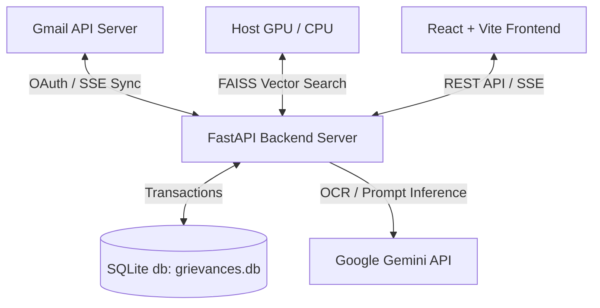

# 🎓 AI Grievance Intelligence System (AICOE)

A full-stack, state-of-the-art enterprise web application for **synchronizing, parsing, categorizing, prioritizing, and generating policy-compliant replies** for Education Department grievance emails. 

Powered by a high-precision, hybrid architecture combining **rule-based expert heuristics, multi-stage Gemini LLMs, visual OCR fallbacks, and a semantic FAISS RAG engine**.

---

## 🚀 Key Features

*   🔄 **Incremental Gmail Sync:** Auto-syncs thread progressions, matching follow-up counts, and folder transitions natively.
*   🏷️ **Hybrid Grievance Classifier:** Instant static/expert keyword heuristics with database-driven dynamic category overrides.
*   ⚠️ **0-6 Tiered Priority Engine:** Evaluates emergency and time-sensitive keywords, with a background Gemini LLM batch-priority refinement.
*   📄 **Multimodal OCR Service:** Direct PDF text extraction with automatic fallback to Gemini Vision OCR for scanned or visual attachments.
*   💬 **Semantic Policy Chatbot:** Instantly query grievances using natural language backed by policy context.
*   🤖 **One-Click RAG Replies:** Generate context-aware draft responses grounded strictly in official policy documents.
*   ⚡ **Hardware-Aware Cooldown:** Dynamic resource manager that pauses background indexers/OCR when active user chat is detected to prevent VRAM overflow.

---

## 🛠️ System Architecture



---

## 📂 Repository Structure

```
AICOE_EDUCATION/
├── backend/                   # FastAPI Backend
│   ├── app.py                 # Core application setup & lifespan
│   ├── main.py                # Uvicorn compatibility bridge
│   ├── config.py              # System configuration & environment tokens
│   ├── ai_utils.py            # AI fallback managers
│   ├── triage_llm.py          # Gemini batch classification & priority engine
│   ├── core/                  # Coordinating tasks, loggers, locks, & GPU resources
│   ├── db/                    # SQLite repository handlers
│   ├── gmail/                 # OAuth clients & synchronization loops
│   ├── rag/                   # FAISS retrieval & grounding engines
│   ├── rag_pipeline/          # Semantic PDF chunk ingestion
│   └── routes/                # FastAPI routing paths (Emails, Settings, RAG)
│
├── frontend/                  # React + TypeScript Frontend
│   ├── src/
│   │   ├── components/        # Email dashboards & reply composers
│   │   ├── pages/             # Dynamic thread panels & views
│   │   └── services/          # Unified Axios API connectors
│   └── package.json
│
├── setup_coe.bat              # Universal installation script
└── docker-compose.yml         # Unified Docker container runner
```

---

## 🔌 Quick Start & Installation

### Option A: Standard Setup (Native Windows)
1. **Ensure Ollama is running on your host machine.**
2. Double-click the **`setup_coe.bat`** script. This script automatically detects your GPU/CPU architecture, configures virtual environments, and installs standard dependencies.
3. Configure your API tokens in `backend/.env` (renamed from `.env.example`).
4. Start the backend:
   ```bash
   cd backend
   venv\Scripts\python main.py
   ```
5. Start the frontend:
   ```bash
   cd frontend
   npm install && npm run dev
   ```

### Option B: Docker Compose Setup
Run the unified multi-stage build directly:
```bash
docker compose up --build -d
```
The application will be running at:
*   **Frontend:** `http://localhost:3000`
*   **Backend API:** `http://localhost:8000`

---

## 🔒 Security & Policy Adherence
*   All user sessions and OAuth credential storage are fully encrypted natively.
*   CORS and safety policies are automatically enforced per `CORS_ORIGINS` configuration.
*   Vector search results are automatically validated against a minimal trust threshold (`0.62`) before drafting responses.
