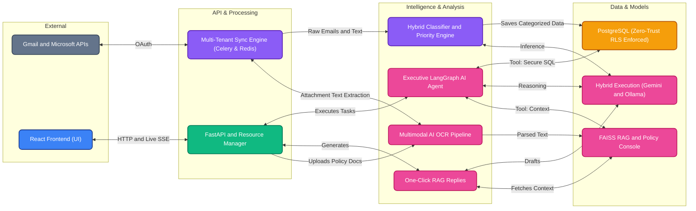

# 🎓 AI Grievance Intelligence System (AICOE)

A full-stack, state-of-the-art enterprise web application for **synchronizing, parsing, categorizing, prioritizing, and generating policy-compliant replies** for Education Department grievance emails. 

Powered by a high-precision, hybrid architecture combining **rule-based expert heuristics, multi-stage Gemini LLMs, visual OCR fallbacks, and a semantic FAISS RAG engine**.

> [!NOTE]
> For a comprehensive business and administrative overview, including compliance and data privacy justifications for Indian Government & PSU deployments, please see the **[Official Government Proposal](AICOE_Final_Government_Proposal.md)**.

---

## 🚀 Key Features

*   🔄 **Multi-Tenant Incremental Sync Engine:** Auto-syncs both **Gmail** and **Microsoft Exchange (Azure AD)** thread progressions in the background. Tracks follow-up counts, intelligently reconciles threads, and natively manages complex mailbox states (trash/untrash/reply).
*   🏷️ **UI-Configurable Hybrid Classifier:** A dual-engine system combining lightning-fast static heuristics with deep background AI processing to accurately map complex complaints against dynamic categories managed entirely through the user interface.
*   ⚠️ **Adaptive 4-Tier Priority Engine:** Evaluates emergency keywords natively while seamlessly augmenting with an AI refinement pass. Administrators can define custom escalation rules, qualitative rubrics, and trigger keywords for every single priority level directly from the settings UI.
*   📄 **Multimodal AI OCR Pipeline:** Direct PDF text extraction with an automatic vision AI fallback for scanned images and visual attachments. Enables deep indexing of non-machine-readable grievance proofs.
*   📚 **Dynamic Policy Console & FAISS RAG:** A dedicated admin interface to upload, index, and manage multi-format regulatory documents (PDF, DOCX, TXT, Images). Automatically applies Vision OCR to scanned documents before ingesting them into a local FAISS vector database for immediate Retrieval-Augmented Generation (RAG) utilization.
*   💬 **Executive LangGraph AI Agent:** An advanced ReAct-based conversational agent that can execute secure SQL queries on grievance data, calculate real-time dashboard KPIs, retrieve historical thread narratives, and search official policy documents via RAG to answer complex regulatory queries.
*   🤖 **One-Click RAG Replies:** Generate and dispatch context-aware draft responses grounded strictly in official policy documents. Uses a tunable semantic FAISS vector search engine to ensure high-fidelity policy alignment.
*   🔒 **Enterprise Security & Zero-Trust Data Isolation:** OAuth tokens and session data are encrypted at rest using symmetric Fernet keys. Complete multi-tenant data isolation is natively enforced via PostgreSQL Row-Level Security (RLS) and strict parameterized queries to prevent SQL injection.
*   🌐 **Hybrid AI Execution (Ollama, Gemini & Vertex AI):** Flexibly operates on either Google Gemini / Enterprise Vertex AI (for strict data residency/zero-training requirements) or entirely offline using secure, local open-source models via Ollama, governed by a mutually exclusive configuration toggle.
*   ⚡ **Hardware-Aware Resource Manager:** Dynamically pauses background indexers, sync loops, and OCR tasks when an active user chat is detected to prevent VRAM/CPU resource starvation.
*   📡 **Real-Time Event Streaming (SSE):** Built on Server-Sent Events for instantaneous, zero-polling UI dashboard updates as new grievances are synced, triaged, and processed in the background.
*   🚀 **Distributed Async Architecture:** Engineered with Celery, Redis, and PgBouncer to reliably handle high-volume parallel workloads and database connections across hundreds of concurrent accounts.

---

## 🛠️ System Architecture



---

## 📂 Repository Structure

```
AICOE_EDUCATION/
├── backend/                   # FastAPI Backend
│   ├── main.py                # Uvicorn compatibility bridge
│   ├── Dockerfile             # Container image definition
│   ├── requirements.txt       # Python dependencies
│   └── src/
│       ├── app.py             # Core application setup & lifespan
│       ├── config.py          # System configuration & environment tokens
│       ├── core/              # Celery config, Resource Managers, GPU Cooldown locks, Logging
│       ├── db/                # SQLAlchemy ORM models, PostgreSQL/SQLite repositories
│       ├── integrations/      # Third-party services (Gmail & Microsoft Graph OAuth/APIs)
│       ├── rag/               # Document ingestion, PDF OCR processing & FAISS index building
│       ├── routes/            # FastAPI routing endpoints (Emails, Policies, Chatbot, Settings)
│       ├── services/          # Core business logic, FAISS RAG Retrieval, Triage Engine, AI Managers
│       ├── utils/             # Helper utilities (Email parsing, cryptography)
│       └── workers/           # Celery distributed background tasks & threaded sync workers
│
├── frontend/                  # React + TypeScript Frontend
│   ├── src/
│   │   ├── components/        # Radix UI/Tailwind components (Dashboards, Chatbots, Modals)
│   │   ├── pages/             # High-level routing views (Inbox, Analytics, Settings)
│   │   ├── services/          # Axios API clients & Data fetching logic
│   │   ├── hooks/             # Custom React state, lifecycle, and React Query hooks
│   │   ├── types/             # TypeScript interfaces & Zod validation schemas
│   │   └── lib/               # Utility libraries (Class mergers, formatters)
│   ├── tailwind.config.ts     # Tailwind CSS configuration
│   ├── vite.config.ts         # Vite bundler configuration
│   └── package.json           # Node.js dependencies
│
├── postgres/                  # Hardened PostgreSQL configs & pg_hba rules
├── nginx/                     # Reverse proxy & API Gateway routing
├── k8s/                       # Kubernetes deployment manifests
├── setup_coe.bat              # Native OS installation script
└── docker-compose.yml         # Distributed enterprise orchestration
```

---

## 🔌 Quick Start & Installation

> [!IMPORTANT]
> **Full Installation Guide:** This Quick Start covers running the code. Before the application will function, you **MUST** configure your Google Cloud and Microsoft Entra ID credentials. 
> Please read the detailed **[INSTALLATION MANUAL](INSTALLATION_MANUAL.md)** for step-by-step instructions on setting up OAuth, security keys, and environment variables.

### Option A: Standard Setup (Native Windows)
1. **Ensure Ollama is running on your host machine.**
2. Double-click the **`setup_coe.bat`** script. This script automatically detects your GPU/CPU architecture, configures virtual environments, and installs standard dependencies.
3. Configure your API tokens in `backend/.env` (copied from `.env.example`) and your UI settings in `frontend/.env` (copied from `.env.example`).
4. Start the backend:
   ```bash
   cd backend
   venv\Scripts\python main.py
   ```
5. Start the frontend:
   ```bash
   cd frontend
   npm install && npm run dev
   ```

### Option B: Enterprise Containerized Setup (Docker)
1. Configure your API tokens and environment variables in both `backend/.env` and `frontend/.env`.
2. Run the fully distributed, production-ready stack (FastAPI, React, Nginx, PostgreSQL, PgBouncer, Redis, and Celery):
```bash
docker compose up --build -d
```

> [!TIP]
> **Updating the System:** If you pull new code or rebuild containers later, **always** run `docker compose down` before running `docker compose up -d --build`. This forces the NGINX proxy to flush its DNS cache and cleanly route to the newly built internal container IPs, preventing 502 Gateway errors.

The application will be securely routed via the Nginx gateway at:
*   **Unified Dashboard & API:** `http://localhost:8000`

### 📖 API Documentation

The application provides auto-generated, interactive API documentation. Once the backend is running, you can explore and test the endpoints at:
*   **Native Setup (Option A):** `http://localhost:8000/docs`
*   **Docker Setup (Option B):** `http://localhost:8000/api/docs`

---

## 🔒 Security & Policy Adherence
*   **Encrypted Storage:** All user sessions and OAuth credentials are encrypted natively at rest.
*   **Data Isolation:** Enforces multi-tenancy natively through PostgreSQL Row-Level Security (RLS) and strict parameterized queries (zero SQLi risk).
*   **Network Security:** Strict HTTP headers (`X-Frame-Options: DENY`, `HSTS`) and `CORS` are inherently enforced.
*   **Dependency Hardening:** Audited and hardened against supply-chain vulnerabilities (e.g., RCE) in the frontend and backend.
*   **AI Guardrails:** Vector search results are automatically validated against a minimal trust threshold (`0.35`) before drafting responses.
